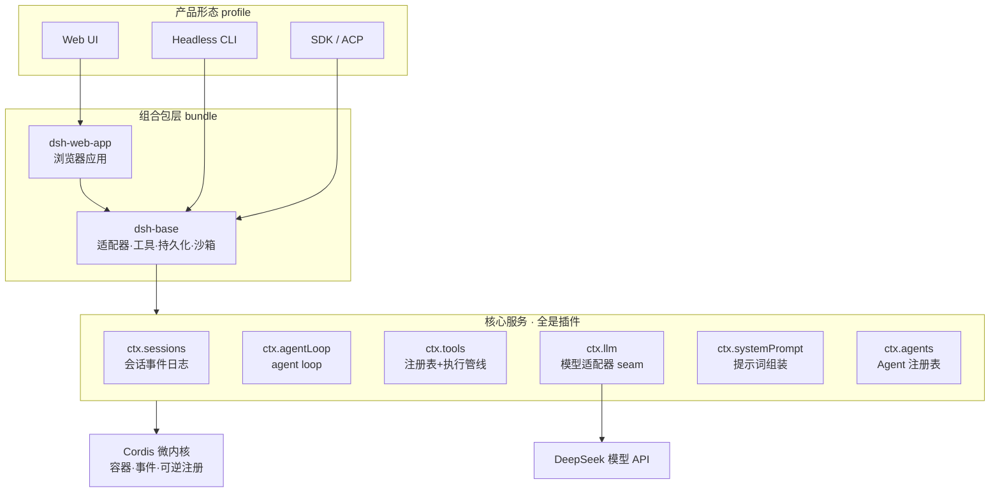
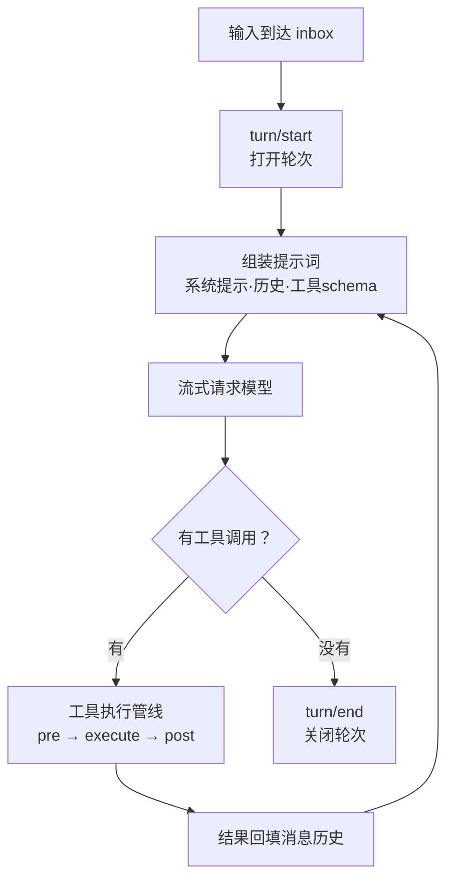

# 第 0 章 · Agent Harness 全景与 PAgent 设计

> 备课出处（选读）：[docs/architecture.zh.md](../deepseek-harness/docs/architecture.zh.md)、[docs/cordis-primer.zh.md](../deepseek-harness/docs/cordis-primer.zh.md)、`AGENTS.md@804eede9eb`（最早期的设计文档链接，外链飞书需登录，未读；历史提交内容不可链接）。

## 本节目标

学完本节，你能：用自己的话说清「模型」和「harness」各管什么；画出 dsh 的分层结构；说出它的核心抽象和三条设计原则；知道 M1–M6 要复刻的是其中哪一块。

## 1. 什么是 Harness：模型是发动机，harness 是整辆车

裸的 LLM 只会一件事：**给定一个消息列表，生成下一条消息**（有时附带「我想调用某工具」的请求）。它没有记忆、没有手、没有眼睛，也不会自己决定什么时候停。

让模型变成能干活的 agent，中间缺的一切就是 harness：

- 把模型请求的**工具调用真正执行掉**，再把结果塞回消息列表；
- **管理上下文**，让对话再长也不会撑爆窗口；
- **把对话存盘**，重启能恢复；
- 管权限与沙箱（工具不能乱来）、装模型适配器（换个模型不改上层）、画 UI。

一句话：**Agent = 模型 + 循环 + 工具 + 上下文管理**。DeepSeek Harness 是这条等式的工业级实现（TS、2.4 万提交、50+ 包）；PAgent 是我们用 Python 把这条等式从零手写一遍——学的是等式，不是那 2.4 万个提交。

## 2. dsh 的分层结构



自下而上读这张图：

- **Cordis 内核**：只提供三样东西——服务容器、事件总线、可逆注册。它不包含任何 agent 逻辑，所以叫微内核。
- **核心服务**：agent loop、会话日志、工具管线、模型适配器……全部是挂在内核上的普通插件。**没有特权代码**：loop 和一个第三方插件地位完全平等，因此每一个都能被替换。
- **组合包（bundle）**：把插件按用途打包装配，`dsh-base` 是所有产品共享的第一层。
- **产品形态（profile）**：同一棵插件树，装配出 Web、命令行、SDK 等不同入口。

## 3. 一切皆插件：Cordis 的五个核心概念

1. **插件是实现 Service 的对象**，挂在上下文上，由框架管理生命周期。
2. **上下文（ctx）是服务容器**：每个服务占一个稳定的 `ctx.<key>`（`ctx.tools`、`ctx.llm`）。别的插件按 key 找服务，而不是直接 import 实现——所以「换一个提供方就换掉整个产品」。
3. **用 `inject` 声明依赖**：插件等依赖就绪才启动；加载顺序由依赖图表达，不靠手工编排。
4. **类型化事件做通信**：五种分发模式（emit 观察 / waterfall 环绕包装 / parallel 并行 / serial 按序 / bail 抢答）。事件就是扩展点。
5. **注册是可逆的副作用**：装一个工具、挂一个监听器都返回释放函数，卸载插件时自动撤销——这就是热重载能成立的原因。

**老师批注（通用 vs 特有）**：Cordis 这套 DI 容器 + 生命周期管理是 TS 生态的框架文化，Python 里没有自然对应物，我们**不复刻**。但里面有两样东西是 Agent 通用原理，M3 起会以 Python 的方式实现同样的思想：**用注册表收集工具**（而不是硬编码 if-else）、**用事件/钩子做扩展点**（而不是改核心代码）。

## 4. Agent Loop：dsh 的心脏

两个词先立住：

- **step（步骤）**= 一次模型请求 + 它调用的全部工具。
- **turn（轮次）**= 从领到一条输入开始，到「模型不再欠任何工作」为止，包含 1 个或多个 step。

简化后的循环骨架（M1 你要亲手写的，就长这样）：

```
input = inbox.claim()            # 领取输入（用户消息 / 注入的上下文）
turn_start()
while True:                      # ← 每个 step
    messages = assemble(...)     # 组装：系统提示 + 消息历史 + 工具 schema
    stream = llm.request(messages, tools)   # 流式请求模型
    if stream.tool_calls:
        results = tools.execute(stream.tool_calls)   # 工具执行管线
        append(results)          # 结果回填 → 欠了新工作 → 再来一轮
    else:
        break                    # 模型不欠工作 → turn 结束
turn_end()
```

dsh 真实的 turn-flow 比这复杂得多（事件瀑布、准入、取消、重试……），但骨架就是上面这几行。**M1 我们的验收标准，就是让这个骨架在你的 Python 里跑起来，且和 loop.spec.ts 的测试场景对得上。**



## 5. 会话日志：单一事实来源

dsh 的会话是一条**只追加的事件日志**（append-only log），这是它最重要的设计原则之一：

> **模型可见即已记录**——凡是进过模型上下文的东西，必定能在日志里重建出来。

好处立刻兑现：模型历史、UI 渲染、会话回放、fork、持久化，全部从同一条日志**投影**出来，不存在第二份真相。日志本身还有版本（v0→v3，每个版本一个迁移包）——这是 M6 的伏笔。

M1 里我们会先把这个原则简化成 Python 版：`Session` 就是一个消息/事件列表，模型看到的一切都先落到列表里。

## 6. 事件三域与能力 seam

- **会话事件**：持久事实，写进日志，重载后仍在。
- **`agent/*` 事件**：实时扩展点，用来观察或拦截进行中的工作（steering、审批都挂在这里）。
- **能力事件**（`fs/*`、`tools/*`）：给某项能力附加策略。

**seam（接缝）**= 一项可替换能力的三件套：接口定义 + 提供方 + 消费方。它的威力在于替换是成片的：文件系统和进程共享同一个接口，把它们的提供方换成远程沙箱，Bash、终端、LSP 就**一起**搬进了沙箱——上层代码一行不改。LLM 适配器也是一个 seam：M1 我们定义 `LLMAdapter` 接口，M1 的 mock 和 M2 的 DeepSeek 是它的两个实现，这就是 seam 思想的第一次落地。

## 7. 我们复刻什么（路线图对照）

| dsh 里的东西 | PAgent 里程碑 | 备注 |
|---|---|---|
| [`core/agent-loop`](../deepseek-harness/packages/core/agent-loop/README.zh.md)（turn/step/inbox/steering） | **M1** | 心脏，含 mock adapter |
| [`packages/llm`](../deepseek-harness/packages/llm)（适配器 seam） | **M2** | 流式 + 中断 |
| [`core/tools`](../deepseek-harness/packages/core/tools)（注册表 + 执行管线 + schema DSL） | **M3** | pydantic 替代 TS schema DSL |
| [`context`](../deepseek-harness/packages/context) / [`compaction`](../deepseek-harness/packages/compaction) | **M4** | token 统计 + 压缩 |
| [`subagent`](../deepseek-harness/packages/subagent) | **M5** | 派生与回收 |
| [`session`](../deepseek-harness/packages/session)（事件日志 + 格式版本化） | **M6** | 保存/恢复/replay |

明确**不复刻**：Cordis 内核、profile/bundle 装配、Web/Desktop 客户端、sandbox、MCP、LSP、遥测。其中诱人的部分记入每节「待探索清单」。

## 8. 亲手点：逛 Web UI

dsh web 已由老师跑在本机 **http://127.0.0.1:3080**（如果没起来，喊一声）。逛的时候带着两个问题：

1. 这个 UI 背后就是第 2 节图里那棵插件树——你能从界面上找到哪些「服务」的影子（会话列表 = sessions，聊天 = agent loop，设置 = settings/plugins）？
2. 如果换掉 `ctx.llm` 的提供方，这个界面会变吗？（答案在 seam 那一节里）

没有 API key 也能逛界面；想真聊一句就把 `.env` 里的 key 准备好（M1 收尾才真正用到）。

## 9. 我的 PAgent 设计（用户填写区）

写 5–10 行就够，写完老师会和你讨论一遍再进 M1。三个问题：

**Q1 它帮你做什么？** 选一个真实、具体、小的场景（例：整理我的下载文件夹 / 每天读一个网页帮我做摘要 / 管理我的待办清单）。越小越好——M1–M6 结束时它要真的能用。

**Q2 最小版本长什么样？** 用户输入什么 → agent 做什么（调哪些工具）→ 什么时候停。

**Q3 明确不做什么？** v1 里砍掉什么（联网？多模态？持久化？并行工具？）。会做减法才算会设计。

（在这里写 ↓）

```markdown
Q1：整理并总结一下微博热搜榜的内容
Q2：用户提供 Q1 写的需求，llm理解需求，调用网页搜索工具，查询资料，交给llm进行总结整理，再把结果用合适的方式呈现给用户
Q3：以当前这个需求来看，暂时不需要 多模态，持久化，并行工具
```

## 待探索清单（超主线，只记名字）

- Cordis 教程（[docs/cordis-tutorial/](../deepseek-harness/docs/cordis-tutorial)）与事件分发细节
- `dsh-base` 组合包里到底装了哪些插件（`dsh --profile web --dump-config` 可以看）
- MCP 工具（[packages/mcp](../deepseek-harness/packages/mcp)）
- Electron 桌面壳（[apps/desktop](../deepseek-harness/apps/desktop)）
- Agent Teams（实验性多 agent 协作）

## 小结与遗留问题

- Agent = 模型 + 循环 + 工具 + 上下文管理；harness 负责循环之外的一切。
- dsh 的架构 = Cordis 微内核 + 一切皆插件 + 组合装配出多种产品形态。
- 三条设计原则：无特权内核（一切可替换）、模型可见即已记录（日志是单一事实来源）、seam 替换成片生效。
- M1 起逐个落地这些思想；Cordis 框架形态本身不复刻。
- 遗留问题：无（本节为概念课）。
