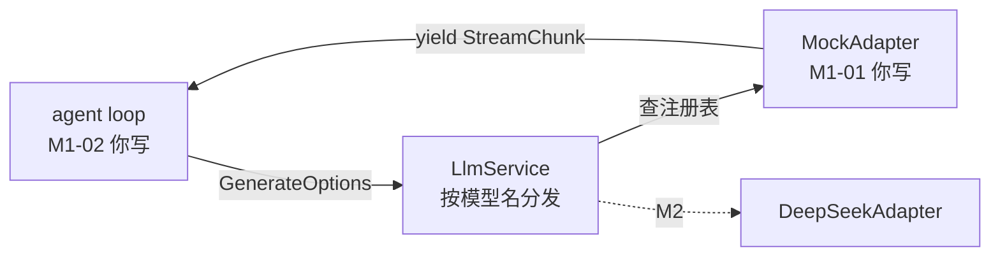

# M1 · 第 1 节 · 接缝先行：词汇表与 Mock 适配器

> 备课出处（选读）：`deepseek-harness@53d1ef4a74` 的 `packages/llm/src/types.ts`（词汇表）、`packages/agent-loop/src/{agent,inbox,index}.ts`、`packages/agent-loop/tests/mock-adapter.ts`（脚本式假模型）、`packages/session/src/types.ts`（事件词汇）、`examples/echo-agent/src/mock-llm.ts`。

## 本节目标

理解「**接缝先行**」：为什么 harness 在写 loop 之前先定下一套与任何模型无关的词汇表和适配器接口。你将亲手写出 PAgent 的第一个 seam 实现——MockAdapter，跑绿 4 个测试。

## 1. 概念讲解：为什么不是上来就写循环？

harness 仓库第 5 个提交（`d5a1d9bb75`）加的是**抽象服务接口包**，第 6 个提交才是 loop。顺序是刻意的：**先把「怎么说」定下来，再写「怎么跑」**。

agent 系统里有三方要说一种共同语言：loop（驱动者）、session（记录者）、adapter（翻译者）。如果先写 loop，loop 会顺手把「DeepSeek 的 JSON 长什么样」写死在自己肚子里——以后每换一个模型都要动刀。harness 的解法是让 `packages/llm/src/types.ts` 成为**唯一词汇表**，文件头一句话就是它的宪法：

> This is the canonical language spoken by the agent loop, session logs, and every plugin. Adapters translate it to provider wire formats; **nothing outside an adapter should ever see a provider-specific shape**.

我们在 PAgent 里已经把这套词汇落地为 [pagent/src/pagent/types.py](../../pagent/src/pagent/types.py)（对照着读一遍），结构完全对应：

| harness (TS) | PAgent (Python) | 作用 |
|---|---|---|
| `ContentBlock` 联合（text/reasoning/tool-call/tool-result/image） | `ContentBlock` + 三个子类 | 一条消息 = 内容块的列表 |
| `Message { role, content }` | `Message(role, content)` | 对话历史的一行 |
| `ToolSchema` | `ToolSchema` | 发给模型的工具说明书 |
| `GenerateOptions` | `GenerateOptions` | 组装好的一次请求 |
| `StreamChunk` 七种 | `StreamChunk` 六种 | adapter 吐的原始流 |
| `FinishReason` 可扩展 map | `FinishReason` 字面量 | 流为什么结束 |

**seam 的三件套**在 [adapter.py](../../pagent/src/pagent/adapter.py) 里齐了：接口定义（`LLMAdapter`）、提供方（`MockAdapter`，你马上写；M2 的 `DeepSeekAdapter`）、消费方（M1-02 的 loop 只跟 `LlmService.stream()` 说话）。从此「换模型」= 换注册的 adapter，loop 一行不改。



## 2. 关键代码片段讲解

### 2.1 词汇表的核心三块（types.ts 提炼）

```ts
// 内容块：每块带 type 标签，是一个「可扩展的联合类型」
interface ToolCallBlock {
  type: 'tool-call'
  id: string          // 模型签发的调用号，和结果配对用
  name: string
  arguments: string   // 原始 JSON 字符串——解析交给执行方
}
interface ToolResultBlock {
  type: 'tool-result'
  toolCallId: string  // 与上面的 id 配对
  content: ContentBlock[]
  isError?: boolean
}
interface Message {
  role: 'system' | 'user' | 'assistant'
  content: ContentBlock[]
}
```

三个值得咀嚼的细节：

1. **`arguments` 是原始 JSON 字符串**，不是对象——模型是流式吐参数的，吐完才谈得上解析；谁解析、解析失败怎么办（回什么给模型）是执行方的事。
2. **tool-call 和 tool-result 用 id 配对**——模型一次可能请求多个工具，回填时靠 id 对号入座。
3. **`Message.content` 是块列表不是字符串**——一条 assistant 消息可以边说话边调工具（文本块 + tool-call 块混排）。这是很多新手实现栽的第一个坑。

### 2.2 chunk 流的固定节奏（mock-adapter.ts 提炼）

```ts
function textResponse(text: string): StreamChunk[] {
  return [
    { type: 'block-start', index: 0, blockType: 'text' },
    ...每个字符一个 { type: 'text-delta', index: 0, text: 字符 },
    { type: 'block-end', index: 0, block: { type: 'text', text } },
    { type: 'usage', usage: { inputTokens: 10, outputTokens: text.length } },
    { type: 'finish', reason: { kind: 'stop' } },
  ]
}
```

节奏五拍：**开块 → 增量 → 收块 → 记账 → 宣终**。`block-end` 直接携带拼好的完整块，消费方可以偷懒不自己组装增量；`index` 把增量绑定到块——一次响应可以同时吐文本块和工具调用块（各占一个 index）。工具调用的结尾是 `finish: tool-calls`，纯文本是 `finish: stop`——**下一节 loop 就靠这个判断「要不要再转一圈」**。

**为什么工具参数也要分片？** 真实模型流式吐参数 JSON，一次一小片；mock 分两半吐（前半带 `name`，后半 `name=None`——工具名在流里只说一次）就是给重组逻辑准备的练习靶子。对 `s = json.dumps(args)` 从 `len(s)//2` 切开，两半拼回去必须正好等于 `s`，测试断言的就是这个。而 `BlockEnd` 里的 `arguments` 始终是完整 JSON 串——不想拼增量的消费方直接拿完整块。

`name=None` 的深层含义：`None` 是「这一片不涉及名字」的哨兵值（区别于空字符串=「涉及了但是空」）。重组器 `BlockAssembler` 信任这个约定，只写了一行 `if (chunk.name) partial.toolCallName = chunk.name`——有新名字才更新，没有就沿用。协议保持最小，重组逻辑保持简单。TS 的可选字段可以整个缺席（undefined），Python dataclass 没有「字段缺席」，所以用 `name: str | None` + 显式传 `None` 表达同一件事。

### 2.3 MockAdapter 的三条规则（脚本模式）

```ts
export class MockAdapter extends LlmAdapter {
  requests: GenerateOptions[] = []          // 记录收到的每个请求
  async *stream(options) {
    this.requests.push(options)             // 规则1：先记账
    const entry = this.script.shift()       // 规则2：取下一条脚本
    if (!entry) throw new Error('MockAdapter: script exhausted')
    for (const chunk of chunks) yield chunk // 规则3：照本宣科
  }
}
```

「脚本化」是它的一切：测试里你排好 3 条响应，loop 来请求三次就按顺序拿到 3 条——**完全确定，所以能写精确断言**。它记下的 `requests` 让测试能断言「loop 发出的请求长什么样」（比如：工具结果有没有被回填进 messages）。这就是第 0 课说的「M1 用假 LLM 学 loop 语义」的全部机关。

### 2.4 M1-02 预告：loop 的表面（agent.ts 一瞥）

```ts
export class LoopAgent implements Agent {
  readonly inbox = new Inbox()      // 两个 FIFO：queued（下个 turn 开头消费）
                                    //           + steering（step 之间消费）
  send(content)   { this.inbox.enqueue(...) }   // 正常排队
  steer(content)  { this.inbox.steer(...) }     // 正在跑？插到 step 之间
  abort(reason)   { this.currentAbort?.abort(reason) }
  start()         { this.done = runLoop(this.ctx, this, ...) }
}
```

loop.ts 主骨架（205 行）的伪代码第 0 课已经给过；M1-02 备课时我们逐段拆它的 turn/step 结构。

## 3. 编码任务（你写，M1-01 作业）

已生成（AI，讲解在课上）：[types.py](../../pagent/src/pagent/types.py)、[adapter.py](../../pagent/src/pagent/adapter.py)、[test_mock.py 的示例测试](../../pagent/tests/test_mock.py#L31)、[pyproject.toml](../../pagent/pyproject.toml)。

**你要写的**（TODO 注释已给足提示；链接可在 VS Code 中点击直达，`#L行号` 会跳到对应行）：

1. [mock.py:52 `tool_call_response()`](../../pagent/src/pagent/mock.py#L52) —— TODO(1)，照 2.2 节的节奏写；finish 是 `"tool-calls"`
2. [mock.py:93 `MockAdapter.stream()`](../../pagent/src/pagent/mock.py#L93) —— TODO(2)，三条规则；记得改成 `async def` + `yield`
3. [test_mock.py:40](../../pagent/tests/test_mock.py#L40)、[test_mock.py:65](../../pagent/tests/test_mock.py#L65)、[test_mock.py:76](../../pagent/tests/test_mock.py#L76) —— 三个测试的断言
4. 全程可以先 `uv run pytest -v` 看进度：目标是 **4 passed**

> `#L行号` 会随代码编辑漂移：写作业期间行号会变，写完后以函数名为准、行为规格以测试为准。

## 4. 运行与验证

- 基线（已验证）：`uv run pytest -v` → **1 passed, 3 failed**（3 个 NotImplementedError 就是你没写的部分）
- 完成标准：**4 passed**；测试细节即行为规格，别改测试来凑实现

## 5. TS vs Python 差异与坑

- **可扩展联合类型没有对应物**：harness 的 `ContentBlockMap` 靠 TS declaration merging 让插件加新内容块；Python 没这机制，v0 用普通类继承 + `isinstance`，要扩展就加子类——这是「框架形态不可迁移」的第一个实例。
- **`AsyncIterable<T>` ↔ async generator**：TS 的 `async *stream()` 和 Python 的 `async def stream()` + `yield` 几乎一一对应。坑：Python 忘了 `async` 不报错，但拿到的是普通生成器，`async for` 会炸——测试会立刻告诉你。
- **`frozen dataclass` ↔ readonly interface**：语义等价（不可变）；但 frozen dataclass 里的 `list` 字段本身仍可变，v0 接受这个妥协。

## 6. 待探索清单

- `SessionEventMap` 事件词汇（`packages/session/src/types.ts`）——M1-02 的主角，本节只需知道它存在
- TS `satisfies` / declaration merging 的扩展套路（Cordis 生态惯用）

## 7. 小结与遗留问题

- 先定词汇和接口、后写循环：接缝先行，换模型零成本。
- chunk 流五拍节奏 + finish 原因是 loop 的方向盘。
- 脚本化 mock = 确定性 = 可测试。
- 遗留问题：无；M1-02 进 loop 本体。
