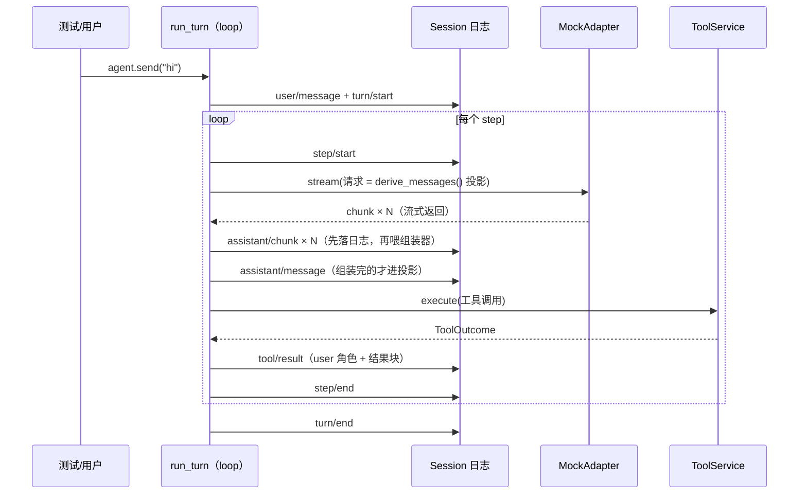

# M1 · 第 2 节 · 主循环：loop、日志与投影

> 备课出处（选读）：`deepseek-harness@53d1ef4a74` 的 `packages/agent-loop/src/loop.ts`（205 行主循环）、`packages/session/src/index.ts`（会话与投影）、`packages/llm/src/assembler.ts`（组装器）、`packages/tools/src/index.ts`（工具服务）。

## 本节目标

理解 loop 周围的三个新角色（会话日志、组装器、工具服务）如何协作，然后**亲手写出 agent 的心脏** `run_turn()`，并用 harness 场景 1 的行为规格验证它。

## 1. 三个新角色

- **Session（[session.py](../../pagent/src/pagent/session.py)）**：只追加的事件日志，第 0 课「模型可见即已记录」原则的落地。append 永不阻塞；**模型历史是日志的投影**，不是第二份列表。
- **BlockAssembler（[assembler.py](../../pagent/src/pagent/assembler.py)）**：把 chunk 增量流拼回完整块。BlockEnd 给的完整块优先，没给就按增量拼；没等到 finish 就当 stop。
- **ToolService（[tools.py](../../pagent/src/pagent/tools.py)）**：注册「名字→实现」，按名执行；**工具炸了不炸 loop**——错误也变成 ToolOutcome 回填给模型，让它自己调整。

### 投影规则（derive_messages，务必吃透）

| 日志事件 | 投影成 | 说明 |
|---|---|---|
| `user/message` | user 消息 | 用户真说的话 |
| `assistant/message` | assistant 消息 | **组装完的**才是历史 |
| `assistant/chunk` | **不投影** | 回放/UI 数据，只落日志 |
| `tool/result` | **user 消息 + tool-result 内容块** | 词汇表没有 tool 角色！ |
| `context/message` / `steering/message` | 带信封的合成 user 消息 | `<context>…</context>`（M1-03 用） |

最反直觉的是最后一行前的两行：**工具结果骑在 user 消息里回填**（OpenAI/Anthropic 系工具回传的通用形态），**chunk 不进历史**（进历史的资格只属于组装完的消息）。

## 2. 一个 turn 的时序



图例：**实线 `->>` = 主动调用，虚线 `-->>` = 返回**。注意一个事实：日志的每一笔都由 loop 写入——模型和工具只把结果**返回给 loop**，从不直接碰日志（对应 TODO(5)(7) 里"先记返回值、再落日志"的顺序）。

## 3. 关键代码片段（harness 提炼）

### 3.1 loop.ts 文件头的自述伪代码（原文件即文档）

```ts
// forever:
//   wait for queued messages (idle)
//   TURN: drain queued → session('turn/start')
//     STEP loop:
//       assembly = ctx.systemPrompt.assemble()
//       req = {model, messages: session.deriveMessages(), signal}
//       stream ctx.llm.stream(req) → session('assistant/chunk'); assembler.push
//       session('assistant/message')
//       each tool-call: session('tool/call'); ctx.tools.execute(); session('tool/result')
//       cont = hadToolCalls || steered
//     session('turn/end')
//   await ctx.parallel('session/flush', session)   ⟵ 持久化检查点
```

注意两个顺序铁律：**chunk 先落日志再喂组装器**（记账优先）；**请求用 deriveMessages() 现场投影**（不存在"手里攒一份消息列表"这种东西）。

### 3.2 工具调用在 loop 里只有五行（原版提炼）

```ts
for (const call of toolCalls) {
  session.append('tool/call', {...})
  const parsedArguments = tryParse(call.arguments)   // 失败回退原始字符串
  const result = await ctx.tools.execute({callId: call.id, name: call.name, arguments: parsedArguments, ...})
  session.append('tool/result', {...})
}
```

### 3.3 投影器对 tool/result 的处理（session 提炼）

```ts
case 'tool/result': {
  messages.push({
    role: 'user',                                   // ⟵ 没有 tool 角色！
    content: [{ type: 'tool-result', toolCallId: callId, content, isError }],
  })
}
```

## 4. v0 简化清单（与 harness 的差异，都有意为之）

| harness | PAgent v0 | 归还时间 |
|---|---|---|
| 永续循环 + 空闲挂起（Promise.withResolvers） | 排空即返回 | M2（与中断一起讲 asyncio.Future） |
| steering 队列（step 间插话） | 无 | M1-03 |
| 实时 agent/* 事件瀑布 | 无 | M3（建事件总线） |
| system-prompt 服务（片段组装） | agent.system_prompt 字符串 | 视需要 |
| session/flush 持久化检查点 | 无 | M6 |
| turn/end 的 aborted/error 原因 | 恒 completed | M1-03/M2 |

## 5. 编码任务（你写）

**[loop.py](../../pagent/src/pagent/loop.py)**：先删掉 `run_turn` 顶部的 `raise NotImplementedError`，然后按 TODO(2)~(10) 逐段实现（TODO(1) 是一行循环）。提示都在注释里，逐段对照第 3 节。

**[test_loop.py](../../pagent/tests/test_loop.py)**：场景 1 的 6 条行为规格已列在测试 docstring 里，你的任务是把规格翻译成断言（Arrange 已备好，别改）。特别注意规格第 6 条——它证明「请求在 assistant 落日志之前组装」这个时间顺序。

## 6. 运行与验证

- 基线（已验证）：`uv run pytest -v` → **5 passed, 1 failed**（mock 全绿，场景 1 等你）
- 目标：**6 passed**；通过后本节 git commit（如 `M1-02: agent loop 主循环`）

## 7. TS vs Python 差异与坑

- `Date.now()` ↔ `int(time.time() * 1000)`（毫秒要自己乘）。
- harness 的 `readonly SessionEvent[]` 只是不让改引用；我们直接返回内部 list 的引用——v0 接受（写坏日志的唯一入口是 append，自律）。
- `switch (event.type)` ↔ `if/elif event.type ==`——语义等价，Python 没有 fall-through 负担。
- async generator 的「调用即返回」在 loop 里无处不在：`agent.llm.stream(request)` 返回的是生成器，`async for` 才开始跑（M1-01 已踩过）。

## 8. 待探索清单

- `renderTagged` 的信封设计（system-reminder 模式：模型如何区分真用户与系统注入）
- `SessionStore` / `onAppend`（持久化插件订阅日志的挂点，M6 的伏笔）

## 附：Cordis 思想的 Python 落地对照（M0 伏笔的兑现）

「不复刻框架形态，用 Python 重写它承载的思想」。Cordis 的服务容器/事件总线/生命周期三样里，只有前两者承载的**思想**值得带进 PAgent；最后一个（HMR/fiber）是 50+ 包互相插拔才需要的重型机制，学习项目彻底不要。

| Cordis 提供 | dsh 用法 | PAgent 的对应物 | 状态 |
|---|---|---|---|
| ctx 服务容器 | `ctx.tools` / `ctx.llm` / `ctx.sessions` | 普通对象当字段传：`agent.tools` / `agent.llm` / `agent.session` | ✅ M1 |
| 注册是可逆副作用 | `ctx.effect(fn)` 装卸 | dict 注册表 + `register()`（v0 不需要可逆） | ✅ M1 |
| 类型化事件总线（waterfall/parallel/…） | 拦截请求/工具/轮次 | 监听器列表（朴素版） | ⏳ M3 |
| 生命周期 / HMR / fiber | 热重载、插件装卸 | 彻底不实现 | ❌ 永不复刻 |
| 声明合并扩展词汇 | 插件加内容块类型 | 加 ContentBlock 子类 | ❌ 永不复刻 |

两个对应的反面教材：工具 if-else 硬编码在 loop 里（对照 `ToolService.register` 的注册表）；审批/审计需求直接改 `run_turn` 本体（对照 M3 的事件监听）。检验标准：**删掉 Cordis，dsh 的 loop 一行不用改也能跑**——loop 只依赖「有一个能注册的地方」，不依赖那个地方是谁。

## 9. 小结与遗留问题

- 会话日志是唯一真相；模型历史 = 投影；chunk 只进日志不进历史。
- 工具结果骑 user 消息回填；工具炸了回错误结果而不是抛出。
- loop 的决策只有一个：本 step 有没有工具调用（M1-03 加 steering）。
- Cordis → PAgent：注册表已有，事件总线 M3 建，框架形态永不复刻。
- 遗留问题：无。
