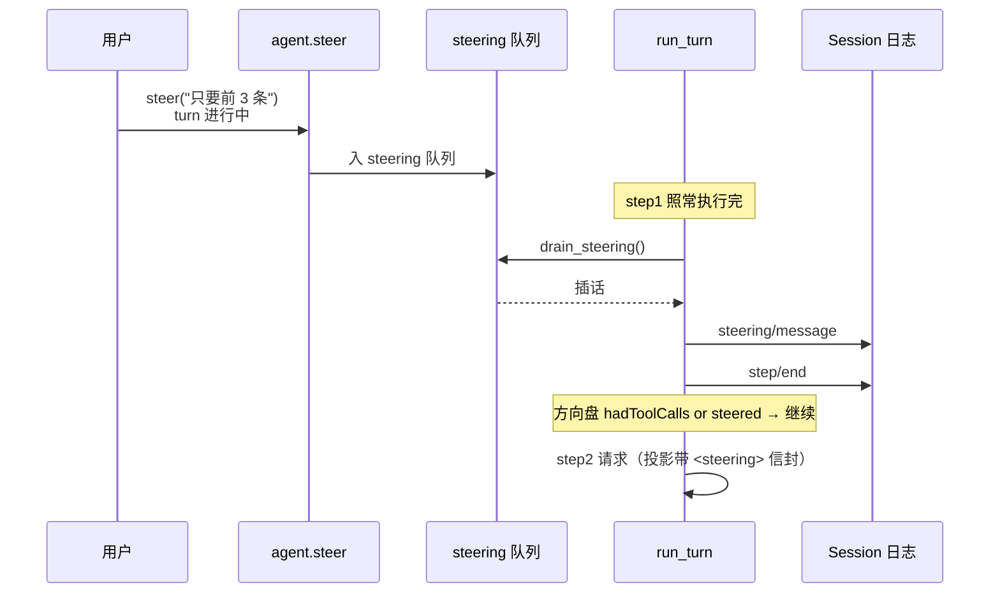

# M1 · 第 3 节 · 双收件箱与转向：steering、inject 与连续轮次

> 备课出处（选读）：`deepseek-harness@53d1ef4a74` 的 `packages/agent-loop/src/agent.ts`（steer 的降级逻辑）、`packages/agent-loop/src/inbox.ts`（双 FIFO）、`packages/agent-loop/src/loop.ts`（step 之间排水）、`packages/session/src/index.ts`（renderTagged 信封）。

## 本节目标

给 agent 装上「运行中改主意」的能力：插话（steering）实时改道、注入（inject）无声补背景、连续排队消息链接成连续 turn。复现 harness 场景 5/6/7/12。

## 1. 一句话理解

**插话 = agent 正在干活时你的新输入，走专用快速通道，在 step 之间被消化；注入 = 悄悄塞给模型一份背景资料，只落日志、不开轮。**

## 2. 概念讲解

两条通道，一张表看清（M1-02 讨论过的伏笔，本节兑现）：

| 队列 | 入口 | 消费时机 | 日志事件 | 投影形态 |
|---|---|---|---|---|
| queued | `send()` | turn 开头整批 | `user/message` | 普通user 消息 |
| steering | `steer()`（仅运行中；空闲自动降级为 send） | **step 之间** | `steering/message` | 带 `<steering>` 信封的 user 消息 |
| （不入队） | `inject()` | 不消费 | `context/message` | 带 `<context>` 信封的 user 消息 |

三个关键点：

1. **降级规则**：`steer()` 只在 turn 进行中走快速通道；空闲时插话没有意义（没有正在跑的 step 可插），降级为 `send`。判断依据是 `agent.running` 标志——由 loop 在 turn 期间维护。
2. **信封投影**：注入/插话投影成 user 消息时被 `<steering>…</steering>` / `<context>…</context>` 包裹（[session.py](../../pagent/src/pagent/session.py) 的 `_render_tagged`，脚手架已写好）。模型靠信封区分「用户正式提问」和「系统塞进来的上下文」——零 adapter 负担的 system-reminder 模式。
3. **消费位置**：插话在 **step 执行完之后、step/end 之前**排水（见下），随即参与方向盘决策——这就是 M1-02 说的 `steered`：「模型还没见过这句话，欠它一次请求」。



## 3. 关键代码片段（harness 提炼，逐行注释）

**steer 的降级逻辑**（agent.ts，两行核心）：

```ts
steer(content, options?) {
  if (this._status !== 'running')          // 空闲：没有正在跑的 step 可插
    return this.send(content, options)     //   → 降级为普通排队
  this.inbox.steer({ content, source })    // 运行中：进 steering 快速通道
}
```

**插话的排水位置**（loop.ts，注意三件事的先后）：

```ts
const steered = agent.inbox.drainSteering()      // ① step 干完后排水
for (const message of steered)
  session.append('steering/message', {...})      // ② 逐条落日志
session.append('step/end', {...})                // ③ 然后才记 step/end
// ...方向盘：defaultDecision = hadToolCalls || steered.length > 0
```

**为什么排水在 step/end 之前**：日志顺序即叙事顺序——「这个 step 干完时，用户说了这话」应该属于 step1 的故事，而不是凭空出现在两个 step 之间的缝隙里。

## 4. 连续 turn（场景 12）

不需要新代码——M1-02 的 `run_loop`（`while has_queued: run_turn`）天然支持：turn1 运行期间 `send()` 到达的消息排队等待，turn1 结束后被下一圈领走开 turn2。**投影跨 turn 累积**（LLM 无状态，「记得上一问」全靠每次全量投影）——场景 12 的测试就是这套行为的回归保护。

## 5. 编码任务（你写）

TODO 分布（提示都在注释里，对照第 2、3 节）：

| TODO | 文件 | 内容 |
|---|---|---|
| A~D | [inbox.py](../../pagent/src/pagent/inbox.py) | `_steering` 队列、`has_steering`、`steer()`、`drain_steering()`（全是 queued 侧的镜像，对照着写） |
| E~F | [agent.py](../../pagent/src/pagent/agent.py) | `steer()`（降级规则）、`inject()`（一行落日志） |
| G | [loop.py](../../pagent/src/pagent/loop.py) | `agent.running` 标志的置位/复位 |
| H~I | [loop.py](../../pagent/src/pagent/loop.py) | step 之间排水 + 落 `steering/message`；方向盘升级为 `had_tool_calls or steered` |

测试断言已由 AI 按规格补全（[test_loop.py](../../pagent/tests/test_loop.py) 后四个测试，读断言即读规格）；场景 5 用了 mock 的**函数条目**（在模型流式返回期间制造插话副作用——M1-01 预告过的第二种脚本风格）。

## 6. 运行与验证

- 基线（已验证）：`uv run pytest -v` → **7 passed, 3 failed**（场景 12 已被现有代码满足）
- 目标：**10 passed**

## 7. TS vs Python 差异与坑

- harness 用 `AgentStatus` 状态机（idle/running/disposed）判断降级；我们用一个布尔 `running`——够用，M2 讲中断时再考虑要不要升级。
- 函数条目里闭包引用 `agent`：Python 晚绑定，函数**调用时**才查名字——所以先定义函数、后创建 agent 也合法（场景 5 用了这一点）。
- `session.append` 的 data 是自由 dict，拼错 key 不报错、投影时才 KeyError——M1-02 的 `conetent` 就是这么溜进来的；拼写检查靠测试。

## 8. 待探索清单

- `renderTagged` 信封里带 source 属性的完整形态（`<steering source="user">`）
- Agent 状态机（idle/running/disposed）与 disposed 后 send 抛错

## 9. 小结与遗留问题

- 双队列 = 正常输入与插话分道；降级规则保证空闲插话不丢。
- 信封投影让模型分得清「谁在说话」；注入不开轮。
- 方向盘完整语义落地：工具结果、插话都算「欠模型一次请求」。
- 遗留问题：无。
