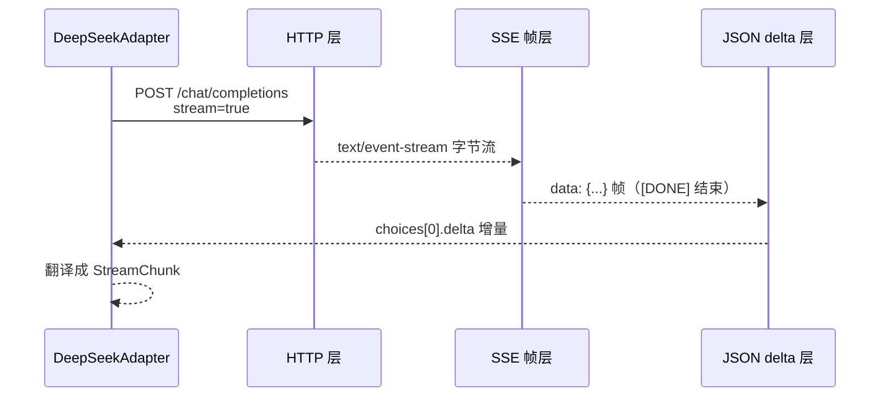

# M2 · 第 1 节 · 真实适配器：从 wire format 到 chunk 流

> 备课出处（选读）：`deepseek-harness` 的 `ab19fed77c`（最早的两个 DeepSeek 适配器，OpenAI 兼容风格）与 master 的 `packages/llm/llm-deepseek/src/{sse.ts,translate.ts}`（现行形态：SSE 帧 → 类型化事件 → 翻译成 StreamChunk 词汇，三层分离相同）。

## 本节目标

终结「预录剧本」时代：写一个真实的 DeepSeekAdapter 实现 M1-01 定下的 `LLMAdapter` 接口——httpx 流式请求 + SSE 解析 + delta 映射。**loop 一行不改**，mock 换真模型。

## 1. 一句话理解

**真实 adapter = 把 DeepSeek 的 HTTP/SSE 方言，逐段翻译成 M1-01 定下的 StreamChunk 词汇的翻译官**——wire format 只活在它肚子里，这正是 M1-01 那条宪法在现实中的兑现。

## 2. 概念讲解：真实模型响应要过三层



**第一层：HTTP 请求**。POST `https://api.deepseek.com/chat/completions`，请求体就是 M1 冒烟见过的 JSON（model / messages / tools / system），多一个 `"stream": true`。头带 `Authorization: Bearer <key>`。

**第二层：SSE 帧协议**（Server-Sent Events）。响应不是一整块 JSON，而是一条文本流，格式固定得像邮政编码：

```text
data: {"choices":[{"delta":{"content":"你"}}]}

data: {"choices":[{"delta":{"content":"好"}}]}

data: [DONE]
```

每帧以 `data: ` 开头、空行分隔；`[DONE]` 是流终结符。**SSE 解析就是逐行读、攒帧、剥掉 `data: ` 前缀**——没有魔法。

**第三层：delta 映射**。每帧 JSON 里 `choices[0].delta` 是增量，映射表（M1-01 的五拍节奏在此会师）：

| DeepSeek delta | 我们的 chunk |
|---|---|
| `delta.content: "你好"` | `TextDelta(text="你好")` |
| `delta.tool_calls[i].function.arguments`（**分片 JSON！**） | `ToolCallDelta(id, name, arguments_delta)` |
| `delta.tool_calls[i].id / function.name`（首帧才有） | 同上，name 只说一次 |
| `finish_reason: "tool_calls" / "stop"` | `Finish(reason=…)` |
| `usage`（最后一帧，需 `stream_options`） | `UsageChunk` |
| `data: [DONE]` | 流结束 |

两个亮点值得咀嚼：**工具参数真的是分片到达的**（M1-01 用 `s[:mid]`/`s[mid:]` 模拟的东西，这里是现实）；**工具名只在第一个 tool_calls 增量出现**（`name=None` 协议的现实原型）。M1 的 mock 不是简化，是忠实预演。

## 3. 接缝兑现：换 adapter，loop 不动

```python
llm.register(["deepseek-chat"], DeepSeekAdapter(api_key=...))
# agent.model = "deepseek-chat"  ← 就这一处差别；run_loop / assembler / session 全不动
```

M1 的 `TerminalUI` 装饰器直接包在真 adapter 外面——终端立即变成流式逐字输出。seam 叠 seam 在真模型上依然成立。

## 4. TS vs Python 差异与坑

- harness 用 `eventsource-parser` 库解 SSE 帧；Python 生态没有默认装的同款，**自己手解**（逐行状态机，本节核心练习）——`async for line in resp.aiter_lines()` 是原材料。
- httpx 的流式响应要用 `async with client.stream("POST", ...) as resp` 上下文管理器，连接在块内才活着。
- DeepSeek 兼容 OpenAI 协议：`reasoning_content`（思考内容）是它家扩展字段，v0 忽略。
- JSON 解析失败/断流是**运行时常态**不是异常态（网络世界），adapter 层要决定：抛给 loop（turn 以 error 结束，M1-04 的机制正好接住）。

## 5. 编码任务

文件：[src/pagent/deepseek.py](../../src/pagent/deepseek.py)——三段式注释（语义/伪代码/样例数据）都在 docstring 里，SSE 样例常量 `SSE_SAMPLE` 可直接对照。

| TODO | 方法 | 语义（一句话） | 复杂处 |
|---|---|---|---|
| A | `_build_body` | GenerateOptions → 请求体（system 单列、TextBlock 拼接、`stream: true`） | — |
| B | `parse_sse` | SSE 全文 → JSON 事件列表（剥 `data: `、`[DONE]` 终结） | 纯函数，测试主力 |
| C | `translate_event` | 单个事件 → 0..n 个 chunk（§2 的映射表） | 工具调用分片分支 |
| D | `stream` | 串装：httpx 流式 POST → 逐行剥壳 → 逐帧翻译 → `[DONE]` 停 | `aiter_lines` 循环 |

测试（断言已由 AI 补全，[tests/test_deepseek.py](../../tests/test_deepseek.py)）：**不联网**——httpx.MockTransport 回放预录 SSE，并捕获你发出的请求体供断言（stream 开了没？messages 形状对吗？）。

## 6. 运行与验证

- 基线（已验证）：`uv run pytest -v` → **12 passed, 4 failed**（四个 deepseek 测试全在等 TODO）
- 目标：**16 passed**
- 真刀真枪加餐（可选）：把 demos/echo.py 的 `llm.register(["echo"], ...)` 换成 `DeepSeekAdapter(api_key=...)`、`model="deepseek-chat"`——mock→real 一行切换，seam 的兑现时刻

## 7. 待探索清单

- master 适配器的事件协议（content_block_start/delta/stop——Anthropic Messages 风格）与本节 OpenAI 风格的差异
- `reasoning_content` 流式（DeepSeek 思考模型）
- 断线重连与 idle watchdog（`DEFAULT_STREAM_IDLE_TIMEOUT_MS`）

## 8. 小结与遗留问题

- wire format 三层：HTTP / SSE 帧 / JSON delta；adapter 是唯一翻译官。
- M1 的 chunk 词汇与分片协议在真实 API 上一一对应——mock 不是玩具，是预演。
- 遗留问题：无。

<a id="lesson-log"></a>
### 实录（节收尾补记）

- 用户实现全程排掉 4 个自产问题：split 参数写反（`"\n".split(text)`）、stream 里 headers 传裸字符串、`_build_body` 忘了调用括号、逐行处理跳过剥壳三步——全部由测试当场抓获或 `-s` 调试定位。**print 不可见之谜**：pytest 默认捕获 stdout，`pytest -s` 才实时可见。
- 验收批改（拍②清单首秀）：必修 3 处——system 塞裸字符串（注释对、代码错）、`model` 硬编码恰好等于测试值（连测试都骗过）、content 拼接未过滤非文本块；规范残骸 = 调试 print 遗迹；注释理解 0 错误（`_SSE_PREFIX` 抽取是好的自作主张）。
- 优化建议（可选，已记）：client 复用（连接池）、`stream_options` 带 usage（M4）、`delta.get("content")` 滤空串。
- 遗留（记入待探索）：工具往返的真实 wire format（assistant 的 tool_calls 消息 + tool 角色结果）——v0 只做了文本路径，M3 真工具接入时补。
