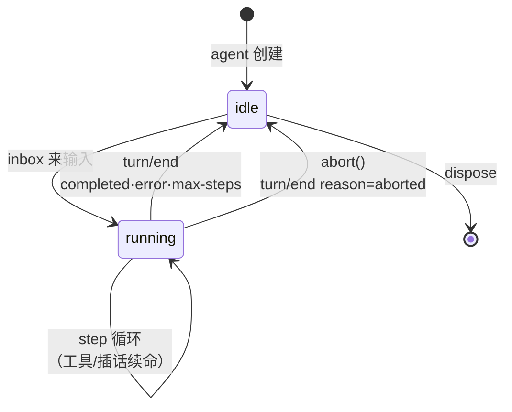

# M2 · 第 2 节 · 中断与挂起归还

> 备课出处（选读）：`deepseek-harness@53d1ef4a74` 的 `packages/agent-loop/src/inbox.ts`（waitForQueued + wakeup）、`packages/agent-loop/src/agent.ts`（abort/start/dispose 生命周期）、`packages/agent-loop/src/loop.ts`（disposed 贯穿循环）。

## 本节目标

归还 v0 让渡的两样东西：**空闲时挂起等待**（agent 变成常驻服务，来一条输入跑一个 turn）和**用户中断**（abort 随时掐断正在跑的 turn，以 aborted 体面收场）。

## 1. 一句话理解

**挂起 = 没活时睡觉、来活时被叫醒；中断 = 主人一声令下，正在跑的 turn 就地立停、登记"因中止而结束"再退场。**

## 2. 概念讲解

### 2.1 永续循环：agent 的一生

v0 的 `run_loop` 是「排空即返回」——每次输入都要外面手动调一次。归还挂起后，它变成**永续循环**：

```text
while 没被关停:
    await 等待新输入（挂起）     # ← 没消息时整个协程停在这一行，不占 CPU
    跑一个 turn
```

**等待的原语是 asyncio.Future（wakeup 模式）**：`wait_for_queued()` 创建一个 Future 挂在那里；`enqueue()` 落消息时顺手 `set_result()` 把它唤醒——和你叫醒一个睡着的人同一个结构：**登记闹钟 → 到点响**。对照 harness 的 `waitForQueued(cancel)`：它用 Promise + 回调实现同一个模式，TS 与 Python 在此一一对应。

### 2.2 中断：cancel 的传播链

Python 的取消是**隐式注入**的：`task.cancel()` 会在该任务**下一个 await 点**抛出 `CancelledError`。链路：

```text
agent.abort() → task.cancel()
  → CancelledError 在 loop 的某个 await 上炸出（最可能在流式循环里）
  → except 捕获（注意：except Exception 接不住它！M1-04 埋过的伏笔）
  → step/end 照落、error 不落 → 落 aborted 收场信息
  → turn/end（reason="aborted"）→ agent 回 idle
```

这就是 types.py 里 `aborted` 这个"已定义未启用"字面量的启用时刻，也是 harness 区分 aborted / error 两种 turn 结束原因的原因：**error 是模型世界的事故，aborted 是人的意志**。日志叙事原则不变：无论怎么死，step/end 和 turn/end 都要合上——回放时才能看出"它是被中止的"。

### 2.3 状态图



## 3. TS vs Python 差异与坑

- TS 的取消靠 `AbortSignal` **显式传递**（每个异步调用都带着 signal 参数，主动检查）；Python 的 `task.cancel()` **隐式注入**——不用传任何东西，但你也控制不了它在哪个 await 点炸，清理逻辑必须假设"任何 await 都可能是中断点"。
- `CancelledError` 继承 `BaseException` 而非 `Exception`：M1-04 写的 `except Exception` 天然放行它——这是语言的善意，本节要主动接住它做体面收场。
- 捕获后**必须 re-raise 或吞干净**，半吞不吐会让取消机制以为任务还活着（asyncio 的坑王）。

## 4. 备课出处

见页首。早期 agent.ts 的三件套（start 返回 disposer / abort 转发到 currentAbort / disposed promise 贯穿循环）是本节脚手架的原型——Cordis 生命周期退场后，等价物是「task 引用 + asyncio.Event」。

## 5. 编码任务

| TODO | 文件 | 语义 | 复杂处 |
|---|---|---|---|
| A | [inbox.py](../../src/pagent/inbox.py) | `wait_for_queued()`：Future 闹钟——有活不睡，没活登记挂起，醒来撤闹钟 | finally 撤闹钟 |
| B | [inbox.py](../../src/pagent/inbox.py) | `enqueue()` 末尾敲钟一行 | — |
| C | [agent.py](../../src/pagent/agent.py) | `start()`：create_task 启动永续循环（本地 import 破循环依赖） | — |
| D | [agent.py](../../src/pagent/agent.py) | `abort()`：`task.cancel()` 一行发信号 | — |
| E | [loop.py](../../src/pagent/loop.py) | `run_loop` 永续化：挂起等输入 + 两处 CancelledError 出口 | 空闲/turn 中两种被取消的收法不同 |
| F | [loop.py](../../src/pagent/loop.py) | `run_turn` 中断收场：单独接 CancelledError → reason=aborted → 末尾 `raise` 抛回 | re-raise（半吞不吐是 asyncio 大坑） |

已备好（AI）：mock 的 `'hang'` 挂起条目（模拟模型卡住，cancel 传播的靶子）、[demo_echo.py](../../demo_echo.py) 异步化 runner（`agent.start()` + `/stop` 命令）、测试断言（[tests/test_abort.py](../../tests/test_abort.py)——含 1 秒超时的「必须体面退场」硬约束）。

**v0 简化（记入教材）**：abort 即停止循环任务（agent 可重新 `start()`）；harness 的「abort 后 agent 仍存活继续值班」依赖 per-step AbortController，待 M2-03 后按需归还。

## 6. 运行与验证

- 基线（已验证）：`uv run pytest -v` → **16 passed, 3 failed**（三个 abort/挂起测试全在等 TODO）
- 目标：**19 passed**
- 亲手点（§5 之后）：`uv run python demo_echo.py` → 输入 `echo 你好` 趁它流式输出时敲 `/stop`——亲眼看 turn 以 aborted 收场；再随便聊一句，agent 复活

## 7. 待探索清单

- harness 的 dispose 与 fiber 生命周期（HMR 安全，M1-02 提过的 spec #15）
- `asyncio.shield`（保护关键收尾段不被二次取消）

## 8. 小结与遗留问题

- 挂起 = Future 闹钟；中断 = cancel 注入 + aborted 体面收场。
- aborted/error 之分 = 人的意志 / 模型的事故。
- 遗留问题：无。

### 实录（节收尾补记）

- **挂死事故与根因**：run_loop 永续化后不再返回，M1 旧测试仍以 `asyncio.run(run_loop(...))` 调用 → 7 处调用点集体挂死（三个 python 进程挂起，强杀收场）。修法：AI 提供 [`run_until_idle()`](../../src/pagent/loop.py) 测试助手（启动→轮询空闲→取消收工）并迁移全部调用点。教训：**改函数契约时，全仓调用点都要跟着改**。
- 用户实现 TODO A~F 全对（wait_for_queued 与伪代码逐行一致、aborted 收场 + 叙事完整 + 抛回），唯一漏项：`start()` 建了任务忘了 `return`（TypeError 即现）。
- 亲手点完成：`/stop` 中断见 reason=aborted、再聊复活。
- 可选残骸：已实现的 TODO(A)~(F) 注释未删。
- 验收时新发现（用户在 loop.py 的自作主张，好的那种）：`error` 与 `reason` 分开管理（M1-04 批改的吸收）。
