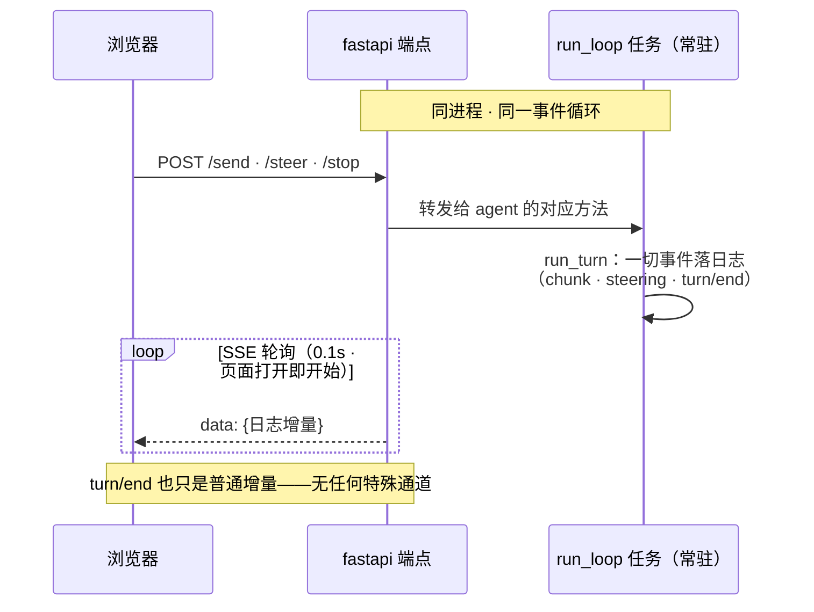

# M2 · 第 4 节 · 事件日志的脸面：Web UI

> 备课出处（选读）：master `packages/web`（Web 应用——我们的极简对照物）与 `docs/agent-lifecycle.zh.md`（Web Session-follow adapter：消费会话事件渲染 UI）。

## 本节目标

用 fastapi 给 agent 一张 Web 的脸：浏览器里看打字机式流式输出、随时插话、随时中断。**你亲手写的是 SSE 服务端**——M2-01 的角色反转，外加 fastapi 入门四件套。

## 1. 一句话理解

**Web UI 是会话日志的投影**：页面零状态，浏览器看到的一切都来自 `session.events` 的增量——第 0 课「模型可见即已记录 / UI 从日志渲染」原则的实物兑现。harness 的 Web 端（Session-follow adapter）就是这个架构的工业版。

## 2. fastapi 入门四件套（官方教程：fastapi.tiangolo.com/zh/）

| 概念 | 长什么样 | 教学注解 |
|---|---|---|
| 路由装饰器 | `@app.post("/send")` | 一个函数 = 一个端点；参数类型即文档 |
| pydantic 请求体 | `class Msg(BaseModel): text: str` | 请求自动校验——**M3 的预告片** |
| lifespan | `@asynccontextmanager async def lifespan(app)` | 服务启动/关闭钩子：agent 在这里拉起与收场 |
| 流式响应 | `StreamingResponse(gen(), media_type="text/event-stream")` | **与 adapter.stream 同构**——async generator 进，流出去 |

## 3. SSE：角色反转

M2-01 我们是 SSE 的**客户端**（逐行剥 DeepSeek 的帧）；本节我们是**服务端**，帧格式一模一样：

```text
data: {"type":"assistant/chunk","data":{"chunk":{"text":"今天"}}}

data: {"type":"turn/end","data":{"turn":1,"reason":"completed"}}
```

浏览器端 `EventSource` 自动解析帧、自动重连——终端 runner 里手工搭的输入线程和轮询播报员，在 Web 里全部白送。**并发输入天然成立**，这正是 harness 做 Web 的原因之一。（「seam 叠 seam」的讨论见 [M2-03 教材「对话疑点」](03-真模型终端对话.md#qa-seam-stack)——Web 是 session 日志的又一层数据消费者，与 TerminalUI 平级。）



读图两要点：① **常驻的是 run_loop 任务**（`agent.start()` = `create_task(run_loop)`，Agent 对象只是容器），且它与 fastapi 端点**同进程、同事件循环**；② **浏览器数据的唯一通道是 SSE 事件流**——Agent 与浏览器之间零直达，一切事件（含 turn/end）都是普通日志增量。三条命令的具体时序见 M2-02 / M2-03 教材。

<a id="known-diffs"></a>
### 已知差异：与 harness Web 对照（刻意不追随的都写明）

集成验收时发现一个真分歧：**abort 语义**。harness 的 abort 只掐当前 turn，agent 回 idle 继续值班（per-step AbortController）；我们的 v0（M2-02 Design B）是 abort 即停止循环任务——终端场景重开进程即可，**Web 场景页面不关，agent 会永久停摆**。当前解法是方案 a：`/stop` 端点在 abort 后自动等旧循环退场并拉起新循环（`demos/web.py` 的复活补丁，标注为临时）。正式归还 harness 语义（abort 存活）记入待探索，M3 真工具接入前或与 M5 多 agent 注册表一起做。

其余差异为**已知且刻意不追随**（概念复刻原则：工程基建不复制）：

| 维度 | harness Web | demo_web | 处置 |
|---|---|---|---|
| 事件投递 | `session/event` 广播，订阅即推 | 0.1s 轮询日志 | 已排期：Session 订阅（待探索首位，M6 兑现） |
| 协议层 | JSON-RPC over gateway（api/sdk 体系） | 裸 REST + SSE | 不追随——网关是工程基建 |
| 会话模型 | 多会话 + SessionStore + fork/resume | 单会话单 agent | M6 主菜 |
| 鉴权 | token 鉴权（本机访问也要带 token）+ SAFETY 边界 | 无（仅绑 127.0.0.1） | 记差异；教学 demo 绑本机风险可控 |

## 4. 页面与范围

页面按官方聊天 UI 风格做极简版：居中对话列、用户气泡靠右、助手消息流式打字、底部输入栏 + 发送/插话/停止按钮。**命令语言与终端一致**（`/steer`、`/stop` 前缀），载体变了、心智不变。明确不做：历史会话列表、多会话（M6 主菜）、视觉精修。

## 5. 编码任务

| TODO | 文件 | 语义 | 复杂处 |
|---|---|---|---|
| A | [demos/web.py](../../demos/web.py) | `GET /events` SSE 端点：轮询 session 增量 → 逐帧 yield（伪代码在注释里） | 断线检测 + seq 续播 |

已备好（AI）：app 与 lifespan（agent 拉起/收场）、三个命令端点（`/send` `/steer` `/stop`，pydantic 请求体）、内嵌聊天页面（HTML/CSS/JS：EventSource 消费 SSE、打字机渲染、命令栏）。交付稿原带 `serialize()` 转换器，实现中被**整个删除**——最终边界一行 `json.dumps(asdict(e))`，始末见下面实录与对话疑点 Q1–Q3。

<a id="lesson-log"></a>
### 编码实录

- **TODO(A) 一次到位**：轮询增量 + `?seq=` 续播 + `is_disconnected` 断线检测，与伪代码完全对齐——终端 runner 里手搭的「输入线程 + 轮询播报员」在 Web 里全部白送，体感成立。
- **首跑翻车两连**：①「运行会报错」的真相是**端口占用**（残留实例占着 8000，winerror 10048）——旧终端没关就重跑，新实例绑定失败即退，报错一闪而过；② SSE **首帧即崩**：日志第一条 `user/message` 的 `content` 装 `TextBlock` dataclass，`json.dumps` 抛 `TypeError`——帧一个都没发出去，浏览器 `EventSource` **静默重连无限循环**，页面零报错。错误信号全在服务端终端（uvicorn 的 traceback）——「没有日志系统吗」的真相：日志一直都在，位置就是 `uv run python -m demos.web` 的控制台；浏览器与服务端的观察窗口对不上，才是「没法定位」的体感来源。
- **serialize() 的生与死**：初始版只特殊处理 chunk（`isinstance` 分派 + 裁剪 + 其余置 `None`），`content` 漏检。修复讨论走了三步——补 `asdict` 转换 → 追问「这行是过滤还是分派」→ 整函数删除，收敛为一行 `json.dumps(asdict(e), ensure_ascii=False)`：`SessionEvent` 本身是 dataclass，`asdict` 递归转净一切；对全部 12 种事件成立靠的是 session.py 词汇表的**不变式**（data 里只有 dataclass 与 JSON 原生类型，凡 `content`/`chunk` 字段必装 dataclass）。
- **AI 收尾清理（脚手架层）**：删除 `serialize()` 遗留的未用 import（`SessionEvent`、`TextDelta`）、注释残骸（`# raise NotImplementedError`）、陈旧伪代码行，import 归位。核心 `gen()` 未动。

<a id="qa-serialize-projection"></a>
### 对话疑点

**Q1 序列化就是投影吗？** 同一原则、不同投影：日志是唯一事实来源，消费者各自推导自己的视图——`derive_messages()` 是**模型视角**投影（选类型、变形状为带角色消息），SSE 序列化是**浏览器视角**投影（全类型、转 JSON、`seq` 断点续播）。两者取材恰好互补：`assistant/chunk` 被模型投影排除（模型只认终态消息），却正是浏览器打字机的主粮——「不进模型投影 ≠ 没人消费」。

**Q2 过滤的层次。** 事件级：SSE 全量发送，筛选住在浏览器 JS（只渲染 chunk 与 turn/end，其余收下即弃）——服务端当笨管道，消费者想多渲染什么改 JS 即可。字段级：初始 `serialize()` 里 `isinstance(chunk, TextDelta)` 那行其实是两个动作——`isinstance` 本职是**类型分派**（认出对象好选转换方式，不是过滤），但「只留 text 扔 index」「其余五种 chunk 置 `None`」是真·字段级取舍。对照 M1-02 的投影两维度：**取哪些 = 类型规则，取多少 = 字段取舍**。

**Q3 `asdict` 与 ClassVar。** `type: ClassVar[str]` 不是 dataclass 字段，`asdict` 输出不含它——但属性照常可读，边界需要时手动补：`{"type": b.type, **asdict(b)}`。为何不把 `ClassVar` 改成普通字段迁就序列化？`ClassVar` 表达的是「类级常量而非实例状态」，改成字段等于允许 `TextBlock(text="x", type="tool-call")` 自报假身份；**序列化适配域模型，而不是相反**——类型判别字段属于「天生要上线」的 wire 模型（M3 的 pydantic 那是它们的地盘）。

## 6. 运行与验证

- 基线与回归：`uv run pytest -q` → **19 passed**（交付时与收尾时各验一次）
- TODO(A) 完成 + `uv run python -m demos.web` + 浏览器 `http://127.0.0.1:8000`：打字机流式 ✓（亲手点确认）
- 全链路机械验证（AI 用 httpx 按时间轴打点：send → 1.2s steer → 1.2s stop → 1.5s send），事件日志摘要：

```text
turn 1: user/message → step1（assistant 已完整作答）→ steering/message 落日志
        → step2 启动（steered = 欠模型一次请求 ✓）→ /stop 正中 step2
        → turn/end reason=aborted ✓（零 traceback，取消被 run_turn 体面收场）
turn 2: 复活补丁拉起新循环 → user/message → assistant「复活成功」
        → turn/end reason=completed ✓
```

- 流式 ✓ 中断 ✓ 插话 ✓ 复活 ✓ = **M2 关闭**（停止/插话的端点级行为由机械验证覆盖；浏览器手感可随时自己再点）

## 7. TS vs Python 差异与坑

- `@app.get` 的端点用普通 `def` 也能返回 async generator 的 StreamingResponse——fastapi 只在需要 await 时才要求 `async def`。
- `dataclasses.asdict` 只认字段（`ClassVar` 不入内）但会递归下钻 dict/list 与嵌套 dataclass——TS 侧 zod schema 显式声明，没有「注解派生 + 类变量排除」这组语义；Python 的坑是 ClassVar 被排除，甜头是递归白送。
- `EventSource` 自带重连并回传 `Last-Event-ID`；我们用 `?seq=` 查询参数简化续播——生产做法见待探索。**坑**：自动重连是静默的，服务端流崩溃时浏览器零报错无限重连，排障必须看服务端终端。
- 旧写法 `@app.on_event("startup")` 已弃用，用 lifespan 上下文管理器。
- Windows 控制台编码（cp936）不会再烦你——浏览器是 UTF-8；但 Git Bash 里 curl 直接 `-d '中文JSON'` 会因编码坏体（"error parsing the body"），写文件或用 httpx 传。

## 8. 待探索清单

- **Session 订阅机制**：给 Session 加 `subscribe()` 异步迭代器（复用 M2-02 的 Future 闹钟做广播），三处 0.1s 轮询（终端播报员、本节 `/events`、`run_until_idle`）全部换成推送——M6（持久化同样要订阅事件流）时一次做三处受益
- 断线重连的 `Last-Event-ID` 标准头
- WebSocket 与 SSE 的取舍（双向 vs 单向）
- harness 的多会话与 Web Session-follow adapter 全貌（M6 后回头很有味道）

## 9. 小结与遗留问题

- UI 是日志的投影：Web 端零状态，四个端点全部薄转发。
- SSE 角色反转完成：客户端（M2-01）+ 服务端（本节）= 流式协议两副面孔。
- 序列化边界一行化：`json.dumps(asdict(e))`——边界只做转换不做筛选，筛选归消费者；对全部事件成立的保证是词汇表不变式（data 只含 dataclass 与 JSON 原生类型）。
- 遗留：工具 wire format（M3 主菜）；abort 后存活语义方案 b（见「已知差异」）；Session 订阅（待探索首位）。
