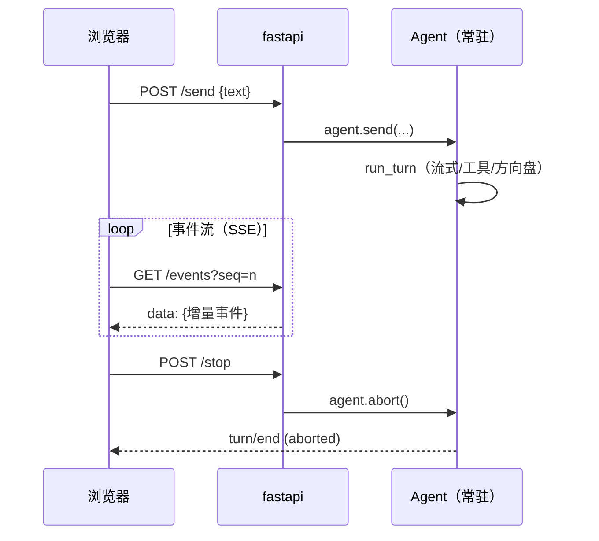

# M2 · 第 4 节 · 事件日志的脸面：Web UI

> 备课出处（选读）：master `packages/web`（Web 应用——我们的极简对照物）与 `docs/agent-lifecycle.zh.md`（Web Session-follow adapter：消费会话事件渲染 UI）。

## 本节目标

用 fastapi 给 agent 一张 Web 的脸：浏览器里看打字机式流式输出、随时插话、随时中断。**你亲手写的是 SSE 服务端**——M2-01 的角色反转，外加 fastapi 入门四件套。

## 1. 一句话理解

**Web UI 是会话日志的投影**：页面零状态，浏览器看到的一切都来自 `session.events` 的增量——第 0 课「模型可见即已记录 / UI 从日志渲染」原则的实物兑现。harness 的 Web 端（Session-follow adapter）就是这个架构的工业版。

## 2. fastapi 入门四件套（官方教程：fastapi.tiangolo.com/zh/）

| 概念 | 长什么样 | 教学注解 |
|---|---|---|
| 路由装饰器 | `@app.post("/send")` | 一个函数 = 一个端点；参数类型即文档 |
| pydantic 请求体 | `class Msg(BaseModel): text: str` | 请求自动校验——**M3 的预告片** |
| lifespan | `@asynccontextmanager async def lifespan(app)` | 服务启动/关闭钩子：agent 在这里拉起与收场 |
| 流式响应 | `StreamingResponse(gen(), media_type="text/event-stream")` | **与 adapter.stream 同构**——async generator 进，流出去 |

## 3. SSE：角色反转

M2-01 我们是 SSE 的**客户端**（逐行剥 DeepSeek 的帧）；本节我们是**服务端**，帧格式一模一样：

```text
data: {"type":"assistant/chunk","data":{"chunk":{"text":"今天"}}}

data: {"type":"turn/end","data":{"turn":1,"reason":"completed"}}
```

浏览器端 `EventSource` 自动解析帧、自动重连——终端 runner 里手工搭的输入线程和轮询播报员，在 Web 里全部白送。**并发输入天然成立**，这正是 harness 做 Web 的原因之一。



## 4. 页面与范围

页面按官方聊天 UI 风格做极简版：居中对话列、用户气泡靠右、助手消息流式打字、底部输入栏 + 发送/插话/停止按钮。**命令语言与终端一致**（`/steer`、`/stop` 前缀），载体变了、心智不变。明确不做：历史会话列表、多会话（M6 主菜）、视觉精修。

## 5. 编码任务

| TODO | 文件 | 语义 | 复杂处 |
|---|---|---|---|
| A | [demo_web.py](../../demo_web.py) | `GET /events` SSE 端点：轮询 session 增量 → 逐帧 yield（伪代码在注释里） | 断线检测 + seq 续播 |

已备好（AI）：app 与 lifespan（agent 拉起/收场）、三个命令端点（`/send` `/steer` `/stop`，pydantic 请求体）、`serialize()`（日志事件 → 浏览器 JSON）、内嵌聊天页面（HTML/CSS/JS：EventSource 消费 SSE、打字机渲染、命令栏）。

## 6. 运行与验证

- 基线（已验证）：`uv run pytest -v` → **19 passed 不回归**（Web 是新增消费者，不碰任何既有逻辑）
- TODO(A) 完成 + `uv run python demo_web.py` + 浏览器 `http://127.0.0.1:8000`
- 亲手点（M2 收官验收）：打字机流式输出 → 输出中点「停止」→ `reason=aborted` → 长回答中「插话」→ 观察改道 → **流式 ✓ 中断 ✓ 插话 ✓ = M2 关闭**

## 7. TS vs Python 差异与坑

- `@app.get` 的端点用普通 `def` 也能返回 async generator 的 StreamingResponse——fastapi 只在需要 await 时才要求 `async def`。
- `EventSource` 自带重连并回传 `Last-Event-ID`；我们用 `?seq=` 查询参数简化续播——生产做法见待探索。
- 旧写法 `@app.on_event("startup")` 已弃用，用 lifespan 上下文管理器。
- Windows 控制台编码（cp936）不会再烦你——浏览器是 UTF-8。

## 8. 待探索清单

- 断线重连的 `Last-Event-ID` 标准头
- WebSocket 与 SSE 的取舍（双向 vs 单向）
- harness 的多会话与 Web Session-follow adapter 全貌（M6 后回头很有味道）

## 9. 小结与遗留问题

- UI 是日志的投影：Web 端零状态，四个端点全部薄转发。
- SSE 角色反转完成：客户端（M2-01）+ 服务端（本节）= 流式协议两副面孔。
- 遗留：工具 wire format（M3 主菜）。
