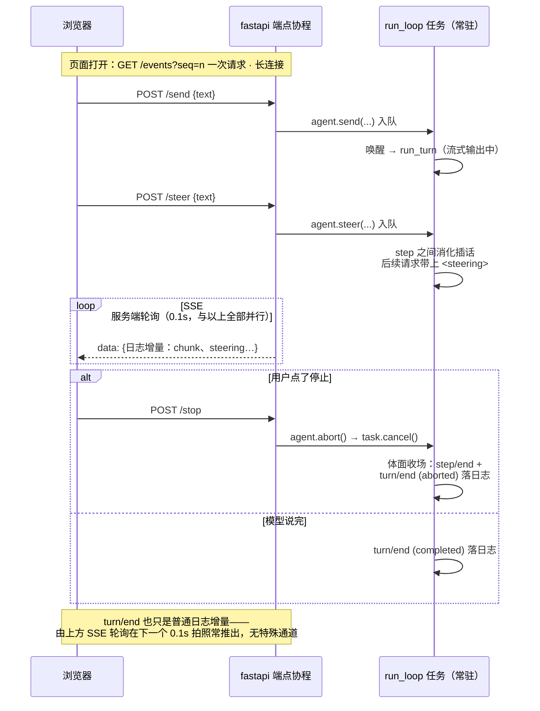

# M2 · 第 4 节 · 事件日志的脸面：Web UI

> 备课出处（选读）：master `packages/web`（Web 应用——我们的极简对照物）与 `docs/agent-lifecycle.zh.md`（Web Session-follow adapter：消费会话事件渲染 UI）。

## 本节目标

用 fastapi 给 agent 一张 Web 的脸：浏览器里看打字机式流式输出、随时插话、随时中断。**你亲手写的是 SSE 服务端**——M2-01 的角色反转，外加 fastapi 入门四件套。

## 1. 一句话理解

**Web UI 是会话日志的投影**：页面零状态，浏览器看到的一切都来自 `session.events` 的增量——第 0 课「模型可见即已记录 / UI 从日志渲染」原则的实物兑现。harness 的 Web 端（Session-follow adapter）就是这个架构的工业版。

## 2. fastapi 入门四件套（官方教程：fastapi.tiangolo.com/zh/）

| 概念 | 长什么样 | 教学注解 |
|---|---|---|
| 路由装饰器 | `@app.post("/send")` | 一个函数 = 一个端点；参数类型即文档 |
| pydantic 请求体 | `class Msg(BaseModel): text: str` | 请求自动校验——**M3 的预告片** |
| lifespan | `@asynccontextmanager async def lifespan(app)` | 服务启动/关闭钩子：agent 在这里拉起与收场 |
| 流式响应 | `StreamingResponse(gen(), media_type="text/event-stream")` | **与 adapter.stream 同构**——async generator 进，流出去 |

## 3. SSE：角色反转

M2-01 我们是 SSE 的**客户端**（逐行剥 DeepSeek 的帧）；本节我们是**服务端**，帧格式一模一样：

```text
data: {"type":"assistant/chunk","data":{"chunk":{"text":"今天"}}}

data: {"type":"turn/end","data":{"turn":1,"reason":"completed"}}
```

浏览器端 `EventSource` 自动解析帧、自动重连——终端 runner 里手工搭的输入线程和轮询播报员，在 Web 里全部白送。**并发输入天然成立**，这正是 harness 做 Web 的原因之一。（「seam 叠 seam」的讨论见 [M2-03 教材「对话疑点」](03-真模型终端对话.md#qa-seam-stack)——Web 是 session 日志的又一层数据消费者，与 TerminalUI 平级。）



读图三要点：① **常驻的是 run_loop 任务**——`agent.start()` 就是 `create_task(run_loop)`，Agent 对象只是容器；② **SSE 轮询归属 fastapi**——代码在 `/events` 端点的 async generator 里，浏览器只发一次 GET（长连接），之后被动收帧；③ **F 与 L 在同一事件循环里**——uvicorn 驱动 fastapi，lifespan 里 create_task 出 run_loop，两者是同进程内的两个任务，不是两个服务。

<a id="known-diffs"></a>
### 已知差异：与 harness Web 对照（刻意不追随的都写明）

集成验收时发现一个真分歧：**abort 语义**。harness 的 abort 只掐当前 turn，agent 回 idle 继续值班（per-step AbortController）；我们的 v0（M2-02 Design B）是 abort 即停止循环任务——终端场景重开进程即可，**Web 场景页面不关，agent 会永久停摆**。当前解法是方案 a：`/stop` 端点在 abort 后自动等旧循环退场并拉起新循环（`demos/web.py` 的复活补丁，标注为临时）。正式归还 harness 语义（abort 存活）记入待探索，M3 真工具接入前或与 M5 多 agent 注册表一起做。

其余差异为**已知且刻意不追随**（概念复刻原则：工程基建不复制）：

| 维度 | harness Web | demo_web | 处置 |
|---|---|---|---|
| 事件投递 | `session/event` 广播，订阅即推 | 0.1s 轮询日志 | 已排期：Session 订阅（待探索首位，M6 兑现） |
| 协议层 | JSON-RPC over gateway（api/sdk 体系） | 裸 REST + SSE | 不追随——网关是工程基建 |
| 会话模型 | 多会话 + SessionStore + fork/resume | 单会话单 agent | M6 主菜 |
| 鉴权 | token 鉴权（本机访问也要带 token）+ SAFETY 边界 | 无（仅绑 127.0.0.1） | 记差异；教学 demo 绑本机风险可控 |

## 4. 页面与范围

页面按官方聊天 UI 风格做极简版：居中对话列、用户气泡靠右、助手消息流式打字、底部输入栏 + 发送/插话/停止按钮。**命令语言与终端一致**（`/steer`、`/stop` 前缀），载体变了、心智不变。明确不做：历史会话列表、多会话（M6 主菜）、视觉精修。

## 5. 编码任务

| TODO | 文件 | 语义 | 复杂处 |
|---|---|---|---|
| A | [demos/web.py](../../demos/web.py) | `GET /events` SSE 端点：轮询 session 增量 → 逐帧 yield（伪代码在注释里） | 断线检测 + seq 续播 |

已备好（AI）：app 与 lifespan（agent 拉起/收场）、三个命令端点（`/send` `/steer` `/stop`，pydantic 请求体）、`serialize()`（日志事件 → 浏览器 JSON）、内嵌聊天页面（HTML/CSS/JS：EventSource 消费 SSE、打字机渲染、命令栏）。

## 6. 运行与验证

- 基线（已验证）：`uv run pytest -v` → **19 passed 不回归**（Web 是新增消费者，不碰任何既有逻辑）
- TODO(A) 完成 + `uv run python demos/web.py` + 浏览器 `http://127.0.0.1:8000`
- 亲手点（M2 收官验收）：打字机流式输出 → 输出中点「停止」→ `reason=aborted` → 长回答中「插话」→ 观察改道 → **流式 ✓ 中断 ✓ 插话 ✓ = M2 关闭**

## 7. TS vs Python 差异与坑

- `@app.get` 的端点用普通 `def` 也能返回 async generator 的 StreamingResponse——fastapi 只在需要 await 时才要求 `async def`。
- `EventSource` 自带重连并回传 `Last-Event-ID`；我们用 `?seq=` 查询参数简化续播——生产做法见待探索。
- 旧写法 `@app.on_event("startup")` 已弃用，用 lifespan 上下文管理器。
- Windows 控制台编码（cp936）不会再烦你——浏览器是 UTF-8。

## 8. 待探索清单

- **Session 订阅机制**：给 Session 加 `subscribe()` 异步迭代器（复用 M2-02 的 Future 闹钟做广播），三处 0.1s 轮询（终端播报员、本节 `/events`、`run_until_idle`）全部换成推送——M6（持久化同样要订阅事件流）时一次做三处受益
- 断线重连的 `Last-Event-ID` 标准头
- WebSocket 与 SSE 的取舍（双向 vs 单向）
- harness 的多会话与 Web Session-follow adapter 全貌（M6 后回头很有味道）

## 9. 小结与遗留问题

- UI 是日志的投影：Web 端零状态，四个端点全部薄转发。
- SSE 角色反转完成：客户端（M2-01）+ 服务端（本节）= 流式协议两副面孔。
- 遗留：工具 wire format（M3 主菜）。
