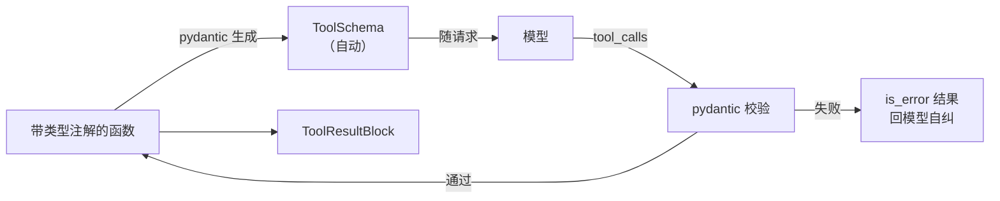

# M3 · 第 1 节 · 工具说明书自动生成

> 备课出处（选读）：`deepseek-harness` 的 `8b5a3ef730`（bash 工具三件套：seam、本地实现、工具注册）与 `ef45ca823a`（defineTool schema-DSL 修复）、[docs/tool-execution-pipeline.zh.md](../deepseek-harness/docs/tool-execution-pipeline.zh.md)。

## 本节目标

新增一个工具 = **写一个带类型注解的函数**——说明书自动生成、参数自动校验、校验失败自动变成错误结果回给模型。

## 1. 一句话理解

**说明书即代码**：工具的 JSON Schema 不再手写，从函数的类型注解自动长出来——模型看到的说明书和真实实现永远是同一份代码，不可能不同步。

## 2. 概念讲解：手写说明书的痛

M1 的 `ToolService.register` 要手写 parameters dict（echo demo 里那段嵌套 JSON）。它有 classic 的「两份真相」病：**说明书说参数是 string，实现函数却可能收 int**——模型按说明书调用，执行时才炸，炸了还得靠 is_error 结果兜底。改动函数签名时，说明书不会自己更新。

**pydantic 的解法**：类型注解是唯一真相，schema 和校验都从它派生——

```python
def fetch_weibo_hot_search(limit: int = 10) -> list[dict]: ...
# 注解 → (自动) → {"type": "object", "properties": {"limit": {"type": "integer", ...}}}
# 调用 → (自动校验) → limit="abc" 直接被拦，错误信息精确到字段
```

harness 用自研 DSL + zod 做同一件事（`defineTool`）：**schema-from-code 是 Agent 通用原理，pydantic 是 Python 生态的选型**。这也是本项目第一个三方运行时依赖（解除「M3 之前不引三方」约定）。

## 3. 校验失败的归宿：还是「错误当数据」

M1-02 定的铁律不变：校验失败 → 包装成 `is_error=True` 的 ToolOutcome 回给模型。升级在于**错误质量**——从「工具执行出错：…」变成「limit 字段应为 integer，收到 str」，模型一次就能改对。

## 4. 注册方式的进化方向

```python
# 现在（M1）：说明书与实现分开登记
tools.register(name=..., description=..., parameters={...}, fn=echo)

# M3 目标：一个函数/装饰器全包
@tool(description="抓取微博热搜榜")
def fetch_weibo_hot_search(limit: int = 10) -> list[dict]: ...
```

`schemas()` 自动从注册表聚合，`execute()` 先过 pydantic 校验再调用——ToolService 的接口不变，内部升级。



## 5. 编码任务

【待补充——M2-03 完成收尾时与脚手架、测试一同补全（`@tool` 装饰器 + 校验管线 + fetch_weibo_hot_search 真工具）】

## 6. 运行与验证

【待补充——同上】

## 7. 待探索清单

- harness 的 tool 执行瀑布（`tools/execute` 事件——沙箱/审批的挂点）
- bash 工具的沙箱与工作目录声明（8b5a3ef730）

## 8. 小结与遗留问题

- 说明书即代码：类型注解是唯一真相，schema 与校验同源。
- 校验失败仍是「错误当数据」，但错误质量升级到字段级。
- 遗留问题：无。
