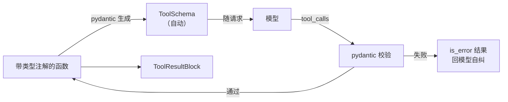

# M3 · 第 1 节 · 工具说明书自动生成

> 备课出处（选读）：`deepseek-harness` 的 `8b5a3ef730`（bash 工具三件套：seam、本地实现、工具注册）与 `ef45ca823a`（defineTool schema-DSL 修复）、[docs/tool-execution-pipeline.zh.md](../deepseek-harness/docs/tool-execution-pipeline.zh.md)。

## 本节目标

新增一个工具 = **写一个带类型注解的函数**——说明书自动生成、参数自动校验、校验失败自动变成错误结果回给模型。

## 1. 一句话理解

**说明书即代码**：工具的 JSON Schema 不再手写，从函数的类型注解自动长出来——模型看到的说明书和真实实现永远是同一份代码，不可能不同步。

## 2. 概念讲解：手写说明书的痛

M1 的 `ToolService.register` 要手写 parameters dict（echo demo 里那段嵌套 JSON）。它有 classic 的「两份真相」病：**说明书说参数是 string，实现函数却可能收 int**——模型按说明书调用，执行时才炸，炸了还得靠 is_error 结果兜底。改动函数签名时，说明书不会自己更新。

**pydantic 的解法**：类型注解是唯一真相，schema 和校验都从它派生——

```python
def fetch_weibo_hot_search(limit: int = 10) -> list[dict]: ...
# 注解 → (自动) → {"type": "object", "properties": {"limit": {"type": "integer", ...}}}
# 调用 → (自动校验) → limit="abc" 直接被拦，错误信息精确到字段
```

harness 用**自研 DSL**（`SchemaSpec` 声明 + `InferArgs` 类型推断 + JSON Schema 转换）做同一件事（`defineTool`）：**schema-from-code 是 Agent 通用原理，pydantic 是 Python 生态的选型**。这也是本项目第一个三方运行时依赖（解除「M3 之前不引三方」约定）。

### harness 的演化切片：一份声明，三个消费者，分三天补齐

`defineTool` 的完整形态不是一次设计出来的，是被疼出来的（SHA 均可 `git show` 选读）：

| 提交 | 类型检查 | JSON Schema | 运行时校验 |
|---|---|---|---|
| ef45ca823a · 定义 DSL | ✓ `InferArgs` | ✓ `schemaSpecToJsonSchema` | ✗ |
| 8b5a3ef730 · bash 工具 | ✓ | ✓ | 手写 `validateBashArgs` 权宜 |
| 36a30180b8 · RFC 005 | ✓ | ✓ | ✓ defineTool 内建 `validateArgs` |

根因：**TS 类型是编译期幻觉，运行时蒸发**——`InferArgs` 推得再准，execute 收到的仍是模型吐的任意 JSON，运行时校验迟早要补。补齐后「一份声明三个消费者」闭环：开发者的类型、模型的说明书、边界的校验全部从同一份声明派生。注意方向差异——TS 是「声明 → 反推类型」，Python 注解运行时健在，是「注解 → 生成 schema」；pydantic 一份声明三角色全包。

## 3. 校验失败的归宿：还是「错误当数据」

M1-02 定的铁律不变：校验失败 → 包装成 `is_error=True` 的 ToolOutcome 回给模型。升级在于**错误质量**——从「工具执行出错：…」变成「limit 字段应为 integer，收到 str」，模型一次就能改对。

## 4. 注册方式的进化方向

```python
# 现在（M1）：说明书与实现分开登记
tools.register(name=..., description=..., parameters={...}, fn=echo)

# M3 目标：一个函数/装饰器全包
@tool(description="抓取微博热搜榜")
def fetch_weibo_hot_search(limit: int = 10) -> list[dict]: ...
```

`schemas()` 自动从注册表聚合，`execute()` 先过 pydantic 校验再调用——ToolService 的接口不变，内部升级。



## 5. 编码任务

| TODO | 文件 | 语义 | 复杂处 |
|---|---|---|---|
| P | [src/pagent/tools.py](../../src/pagent/tools.py) | `model_from_fn(fn)`：`inspect` 签名 → pydantic `create_model`——说明书自动生成的核心 | 默认值→`Field(default=…)`、无默认→必填 `(注解, ...)` |
| Q | 同上 | `@tool(description=…)` 装饰器：生成模型 + 组装 `ToolDef` 进 `REGISTRY`，**原函数原样返回** | 带参装饰器的双层结构 |
| R | 同上 | 单表门面 + 校验跟代码走：`schemas()`/`execute()` 只认唯一 `REGISTRY`；`model` 非 None 才宿主校验，None（register 裸说明书入口）不校验 | `model` 可空 = 如实记录「契约有无代码可读」 |

作业区（AI）：[tests/test_tools.py](../../tests/test_tools.py)——四条 @tool 用例（交付时 skip 挂起、逐条解锁，全程见实录）+ 一条「裸说明书工具不宿主校验」统一语义规格测试 + 两条回归护栏。

<a id="lesson-log"></a>
### 编码实录

本节走了「参考实现 → 删除重写」的路：用户 pydantic 陌生，主动要求 AI 生成参考实现供学习（沿 M1-01 例外先例，决策记录在案）——读懂、删除、对照 TODO(P)(Q)(R) 重写，pydantic 三件套（`create_model` 动态建类、Ellipsis 必填哨兵、`model_validate`→`model_dump`）全部亲手落地。

**两轮拍②的 bug 谱系**——全部集中在「边界与契约」，核心逻辑零错：

1. `schemas()` 丢了 `self`——实例方法第一个参数是调用者本身，忘了它所有调用方全炸（连 loop 的测试都红：`run_turn` 每步都调 `schemas()` 组装请求）；
2. `execute()` 签名漂移——多加 `id` 参数、`params: str` 注解说谎（实参是 dict）。**接口签名由调用方决定，不由实现者灵感决定**；
3. `tool(desc)` 改名违约——带参装饰器的参数名是公开契约，测试按 `description=` 关键字调用，改名即 `unexpected keyword argument`；
4. `tool.name` 写在 `tool is None` 分支里——想给「未知工具」报工具名，取的却是刚判空的变量；工具名在查表用的参数 `name` 上。这条还连坐了 loop 测试：AttributeError 炸进 `run_turn` 的 `except Exception` → 循环提前断。

另两个值得留档的事实：AI 的参考实现自己也带了 bug（`d.model_validate` 写成在 ToolDef 上找校验器）被测试当场抓——**「测试是行为规格」双向成立，既规格化你的实现也拦截 AI 的笔误**；用户版 `model_from_fn` 对缺注解直接 `raise TypeError`，比参考实现的 Any 兜底更严格、更符合 fail-fast，被验收采纳保留。

<a id="qa-schema-from-code"></a>
### 对话疑点

**Q4 defineTool 与 zod 什么关系？** 没关系——本节教材初稿写「自研 DSL + zod」是备课错误，已修正：zod 只在 `packages/api` 网关做 HTTP 校验；工具 DSL 是纯自研，注释里明确拒绝 schemastery，理由是**工具参数要的主产物是 JSON Schema（wire format），不是校验器**——选型标准：以最小表面积直达 wire format。

**Q5 MCP 外来工具为什么不能用注解处理？** 注解是「进程内代码」的属性，而 MCP server 是独立进程，工具以**协议数据**到达（`tools/list` 的 JSON，`inputSchema` 就是现成的 JSON Schema，harness 的 `syncTools` 原样采用、`execute` 只是一行 `callTool` RPC 转发）。自家工具走「注解 → 模型 → JSON Schema」，外来工具从终点直接入场——两条路在 wire format 汇合。手写带注解的 stub 去包外来工具 = 把「两份真相」病请回来。反方向（JSON Schema → 反建模型）存在但默认不用：校验跟代码走，server 的参数 server 管。

**Q6 两种工具为什么曾用两张表？能统一吗？** 来源的差异（代码派生 vs 数据到达）永远存在，但**构造后形态可以统一**：`ToolDef` 加 `parameters`（构造时定型为 JSON Schema）+ `model: … | None`（None = 无代码可校验）。执行侧天然统一——**函数是万能适配器**（本地计算、RPC 转发都能包成 Callable）。统一是「第二个居民到来」时的重构决策：M1 只有一种工具时不该赌形态，M3 外来形状出现后单表正当时——本节已落地（见决策记录）。

**Q7 `ensure_ascii=False` 为什么总在用？** 它只决定非 ASCII 字符输出为原文还是 `\uXXXX` 转义——两者都是合法 JSON，解析结果相同。我们的消费方是 JSON.parse 类（浏览器、模型、自己的 loads）：原生中文可读、省 token（`\u4f60` 是 6 个 ASCII 字符好几个 token）、省字节；只有「编码未知的存储/通道」（如 M6 写文件忘 `encoding="utf-8"`）才轮到默认 True 的无脑安全牌。**规则：面向可解析的消费者用 False，面向未知编码的存储用 True。**

**Q8 `...` 是什么写法？** 内置单例 `Ellipsis`，不是省略号语法糖。pydantic 拿它当**必填哨兵**——`None` 会与合法默认值撞车，Ellipsis 永不撞车；同族思想见 `inspect.Parameter.empty`（哨兵模式）。它还兼职两副面孔：函数体占位 `def f(): ...`（等价 pass，约定表达「待实现」，.pyi 存根全用它）、类型注解 `Callable[..., str]` 的任意参数匹配。

已备好（AI）：统一记录 `ToolDef`（`model: … | None` 标记契约来源——代码派生 or 数据到达）、唯一注册表 `REGISTRY`、pydantic 依赖（**本项目第一个三方运行时依赖**，`uv add pydantic` 已装）；M1 `register()` 收编为裸说明书入口（`model=None`，为 MCP 形状的外来工具预留）。

## 6. 运行与验证

- 重写完成：`uv run pytest -q` → **26 passed**（6 条 tools 测试全绿，loop/abort 全量不回归）
- `schemas()` 的产出可以直接打印看看——那正是发给模型的说明书原文（`model_json_schema()` 附带 `title` 等元数据，wire format 容忍，无害）
- 收官亲手点在 M3-03 兑现：把真工具接进 DeepSeek agent，亲眼看模型调用它、亲手加自己的工具

## 7. 待探索清单

- harness 的 tool 执行瀑布（`tools/execute` 事件——沙箱/审批的挂点）
- bash 工具的沙箱与工作目录声明（8b5a3ef730）

## 8. 小结与遗留问题

- 说明书即代码：类型注解是唯一真相，schema 与校验同源。
- 校验失败仍是「错误当数据」，但错误质量升级到字段级。
- 遗留问题：无。
