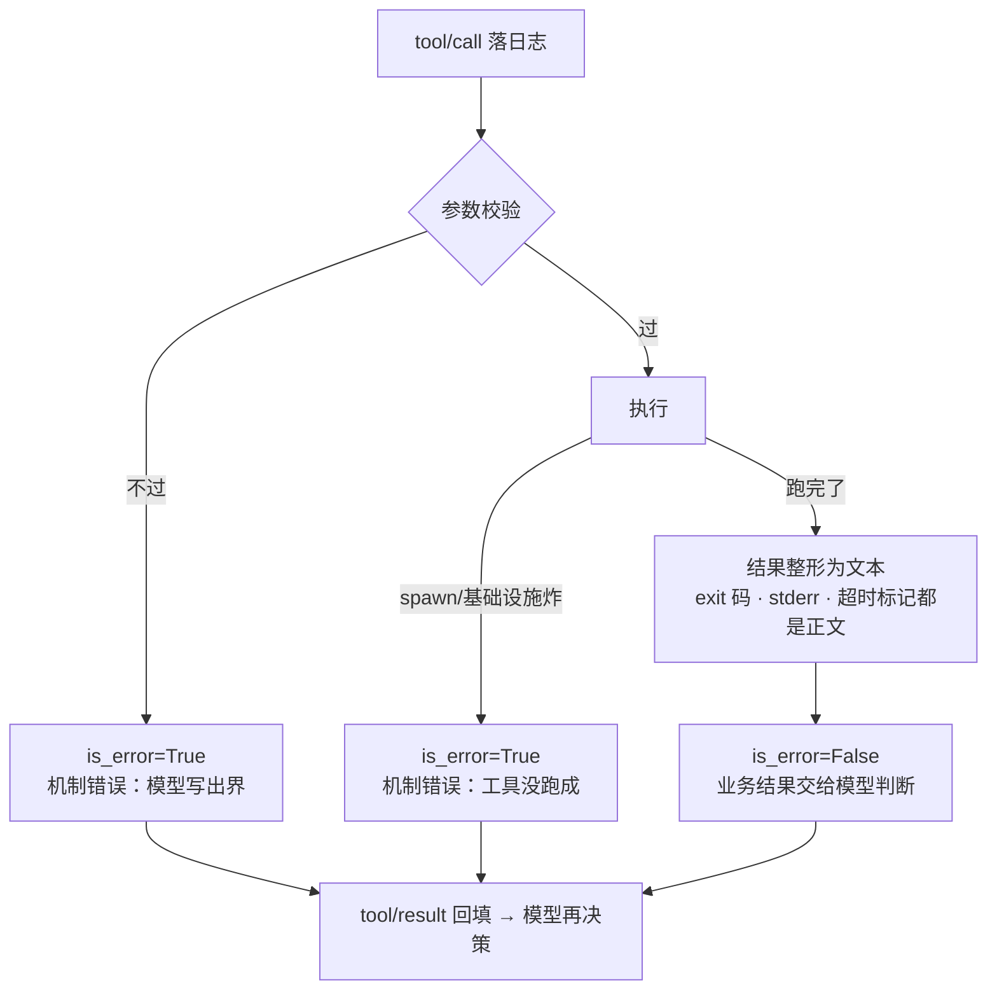

# M3 · 第 2 节 · 真实工具解剖：bash 三件套与错误分层

> 备课出处（选读）：`deepseek-harness` 的 `8b5a3ef730`（bash 执行三件套：`packages/bash` 接口、`packages/bash-local` 本地实现、`packages/tool-bash` 模型界面）与 [docs/tool-execution-pipeline.zh.md](../../deepseek-harness/docs/tool-execution-pipeline.zh.md)（master 现状，瀑布全景）。

## 本节目标

解剖一个「真实工具」的完整尸体：schema、校验、执行、**结果整形**、**错误分层**。学完你能把 M3-01 的 `@tool` 函数升级成模型友好的成品——知道哪些失败该 `is_error`、哪些该当数据上报，以及怎么把结果排版成模型一次读懂的文本。

## 1. 一句话理解

**工具结果的第一读者是模型，文字是它唯一的感官**——stdout、stderr、退出码、超时，都要整形拼装成一段模型一次读懂的文本；而「失败」要分层：机制坏了才 `is_error`，业务不顺只是数据。

## 2. 概念讲解

### 三件套：模型看到的与怎么执行的解耦

bash 提交拆了三个包：`packages/bash` 只放接口与词汇类型（`BashExecutor` seam），`packages/bash-local` 是本地子进程实现，`packages/tool-bash` 是模型界面——「pure schema + text shaping」，每个进程细节都躲在 `ctx.bash` 缝后面。**换执行器（沙箱/远程/权限版）不动模型视野**——这是 M1 adapter seam 的同构复用，harness 用三个包表达，PAgent 用模块边界表达即可（概念复刻，不复制 monorepo 形态）。

### 错误分层：`is_error` 只给机制错误（本节核心）

`renderResult` 的注释一锤定音：**Non-zero exits are REPORTED, not errored**——命令退出码非零、有 stderr、超时被掐，全都整形进正常结果文本；只有 spawn 失败、abort 这类**基础设施故障**才 `is_error=True`。对照 M1-02 铁律「工具失败 = 数据，不是异常」，本节是把「失败」再切一刀：



为什么这么分？`is_error` 是给模型的**信号**：「你刚才那次调用本身有问题，换姿势」；而 `exit 1` 是**业务事实**：「命令跑完了，它自己说不满意」——grep 没匹配到也退出非零，模型看到输出自己会调整。把业务不顺标成 error，等于替模型做了「这算失败」的判断，抢了它的决策权。

### 结果整形：给模型的排版

模型读纯文本，harness 的排版规则值得照抄：stdout 打头 → stderr 用 `[stderr]` 分节 → 尾部状态标记（`[exit code: 1]`、`[timed out after 5000ms]`、`[killed by signal: SIGKILL]`）→ 空输出用哨兵 `(no output)`。截断时附通告与全量输出落盘路径。每条标记都是「模型下一步决策的输入」。

### 运行时校验：模型产出不可信

这个提交里 `validateBashArgs` 是**手写**的逐字段检查，注释明说是权宜之计（RFC 005 之后由 `defineTool` 按 schema 自动校验）。根因：zod schema 只在**编译期**给 TS 用，运行期 `arguments` 就是模型吐的任意 JSON——每个字段都得查。PAgent 的 pydantic 是运行时原生校验，M3-01 的 `execute()` 管线一步到位，没有这道历史弯路——但「模型产出 = 不可信外部输入」的意识必须建立。

### 后台任务与 `agent.inject()`：通知不是唤醒

`run_in_background` 的任务完成时，harness 往会话里 `inject()` 一条简短通告——注意语义：注入是**下一次模型请求的上下文**，不是唤醒信号，空闲的 agent 依旧空闲。所以工具描述里明确教模型「用 `bash_output` 轮询」。这正是 M1-03 `<context>` 信封通道的真实用途：工具经由注入通道往会话里写上下文。

## 3. 关键代码片段讲解

`packages/tool-bash/src/index.ts` 提炼（TS 原文，语义已注）：

```ts
export function renderResult(result: BashRunResult): string {
  const out = streamText(result.stdout)      // 截断过的流会附「全量输出在 xxx」通告
  const err = streamText(result.stderr)
  let body = out
  if (err.length > 0) {
    if (body.length > 0 && !body.endsWith('\n')) body += '\n'
    body += `[stderr]\n${err}`               // stderr 单独分节，不和 stdout 混流
  }
  if (body.length === 0) body = '(no output)' // 哨兵：空输出也是信息

  const markers: string[] = []
  // 超时独立上报：命令可能 trap SIGTERM 后 exit 0，模型必须知道它被掐过
  if (result.timedOut) markers.push(`[timed out after ${result.timeoutMs}ms]`)
  if (result.signal !== null) markers.push(`[killed by signal: ${result.signal}]`)
  else if (result.exitCode !== 0) markers.push(`[exit code: ${result.exitCode}]`)
  if (markers.length === 0) return body      // 全绿：正文即全部
  if (!body.endsWith('\n')) body += '\n'     // 按需补换行：数据自带尾换行就不重复
  return body + markers.join('\n')           // 业务结果全在正文，is_error 保持 False
}
```

读法：**这个函数从不抛错**——它的输出永远是一段可读文本；「失败」的浓度全靠正文里的标记传达，`is_error` 只留给调用 `renderResult` 之前的机制故障。手写校验的样子（将来被 schema 自动化取代）：

```ts
function validateBashArgs(args: {...}): void {
  if (typeof args.command !== 'string' || args.command.trim().length === 0)
    throw new Error('invalid command: expected a non-empty string')
  if (args.timeoutMs !== undefined && (typeof args.timeoutMs !== 'number' || args.timeoutMs <= 0))
    throw new Error(`invalid timeoutMs: expected a positive number, got ${JSON.stringify(args.timeoutMs)}`)
  // …每个模型可能产出的字段逐一查——运行期没有类型系统替你把关
}
```

## 4. 备课出处（选读）

- `git -C deepseek-harness show 8b5a3ef730:packages/tool-bash/src/index.ts`（本节主文：schema、校验、`renderResult`、后台通告）
- `git -C deepseek-harness show 8b5a3ef730:packages/bash/types.ts`（BashExecutor seam 词汇：`BashRunResult` 的 stdout/stderr/exitCode/signal/timedOut）
- `git -C deepseek-harness show 8b5a3ef730:packages/bash-local/src/run.ts`（进程组、SIGTERM→SIGKILL、tail 截断 + 全量 spill 落盘——工程浓度高，选读）
- master 的 [docs/tool-execution-pipeline.zh.md](../../deepseek-harness/docs/tool-execution-pipeline.zh.md)（瀑布全景：pre/execute/post 三道瀑布、审批、守卫——属工程基建，PAgent 不复刻，见待探索）

## 5. 编码任务

| TODO | 文件 | 语义 | 复杂处 |
|---|---|---|---|
| S | [src/pagent/tool_bash.py](../../src/pagent/tool_bash.py) | `render_result`：结果整形纯函数——stdout 打头、`[stderr]` 分节、`(no output)` 哨兵、尾部状态标记逐行追加 | 纯函数永不抛错；`timed_out` 与 `exit_code` 两条独立标记 |
| T | 同上 | `bash_run`：`@tool` 接第一个真活——subprocess 执行 + 错误分层 | `OSError` 让它炸出去（execute 兜成 is_error）；`TimeoutExpired` 必须自己抓（超时是数据！） |

作业区（AI）：[tests/test_tool_bash.py](../../tests/test_tool_bash.py)——`render_result` 四分支 + `bash_run` 四层行为（含 `monkeypatch` 模拟 spawn 故障），交付时全部 skip 挂起。`[exit code: 1]` 那条是本节灵魂：**非零退出 is_error=False**。
已备好（AI）：文件骨架与 TODO 注释；M3-01 的 `@tool` 直接可用——装饰即注册，测试从 `REGISTRY` 全管线走。

<a id="lesson-log"></a>
### 编码实录

本节 TODO(S)(T) 全程从零手写（无参考实现，只有骨架注释+伪代码）。`bash_run` 一次成型（echo 与 spawn 故障两条直接绿）；`render_result` 经四轮迭代收敛，**bug 谱系本身就是教材**：

1. **哨兵提前 return 吞标记**——`(no output)` 后直接 return，`[timed out]` 永远到不了。教训：哨兵是 body 的**替换**，不是函数的出口；
2. **`stdout.strip()` + `"\n".join`**——strip 违反「原文打头」（尾部换行是数据），join 表达「无条件分隔」而 spec 要「按需追加」，双换行当场现形；
3. **哨兵时序回归 + 空 body 条件缺失**——重构时哨兵跑回 stderr 合入之前（只查 stdout）；`"".endswith("\n")` 为 False，空 body 被补出行首孤换行。后者被前者遮住，修 A 冒出 B；
4. **`body =` 顶掉 stdout**——stdout 与 stderr 同时非空时 stdout 被整体丢弃。四条测试恰好都是单侧非空，`=` 与 `+=` 在它们眼里等价——**拍②扫描（测试没覆盖的路径）补锁一条后现形**。

**教材勘误一次**：老师简化 §3 片段时丢了 harness 的 `if (!body.endsWith('\n'))` 条件行，用户顺着双换行 trace 逼到原文核实抓出——「注释说 A、代码做 B」的扫描方法对老师同样成立，测试/spec/片段三方不一致时，以原文为准。

<a id="qa-errow-layering"></a>
### 对话疑点

**Q1 非零退出怎么会 stderr 为空？** 退出码和 stdout/stderr 是**三个互相独立的信道**：退出码是进程留给父进程的机器可读状态，不承诺失败原因写在 stderr。grep 无匹配、diff 有差异、test 条件判断都**故意**静默 + 用退出码表达结果（协议化设计，方便脚本 `if grep …`）。「非零退出 + 全静默」是一大类命令的正常形态——也正是最欺骗模型的形态：只看到 `(no output)` 会误判「成功但没输出」，看到 `(no output)\n[exit code: 1]` 才知道「失败了，换姿势」。

**Q2 为什么不能先删换行再加（strip-then-join）？** 对模型而言换行大概率无损（语义级阅读），这个直觉基本成立；但 (a) 尾换行是数据的一部分，spec 与四条测试已锁定契约，**改契约必须显式**（spec+测试+理由一起动），不能以实现捷径溜入；(b) `rstrip` 是全剥——`printf "a\n\n\n"` 的两个真实空行也被删。**落点修正**：「模型需要多高保真」是 M4 压缩策略的开题公案，不是本节的实现自由度。

**Q3 接缝加的换行不也动了数据吗？** 影响分两类：**删**不可恢复（模型无法回答「输出以换行结尾吗」）；**加**落在两段事实的边界且紧跟标签——`"hi\n[exit code: 1]"` 里那个 `\n` 是标记的第一个字节，不产生关于命令输出的错误信念。判据不是「字节变没变」而是「**会不会引发错误推断**」，精化版：损失不可怕，**静默的损失才可怕**——截断有通告 + spill 文件找回，哨兵是「空」的显式编码，rstrip 却无通告无找回。`boom\n` 的尾换行还演示了双重身份：它是数据字节，兼職分隔符；输入 `boom`（无尾换行）时信封补一个，两种输入同一输出——结构归一化边界，数据保真。

**Q4 后台任务为什么「通知不是唤醒」？** `run_in_background` 立即返回 task id；完成时 harness `onTaskDone` 回调 `agent.inject()`——往会话写一条持久事实（含下一步提示「用 bash_output 读取」）。inject 是**信息入账**（下次请求可见），不是**行为驱动**（不碰 inbox、不唤醒挂起的 wait_for_queued、不开新 turn）。三个理由：①驱动权只在 inbox（用户/steering），后台完成也能唤醒 = agent 半夜自作主张；②时序——turn 进行中通告插不进已发出的请求，空闲时唤醒又引入 mid-stream 竞态，最坏代价只是「下轮才被看见」；③append-only 天然幂等。**契约的另一半写在工具描述里**（「poll it with bash_output」）——一部分协议不在代码里，在模型读得到的文字里。PAgent 对应物：`inject()`（M1-03）与 `send()` 的分工。

## 6. 运行与验证

- 重写完成：`uv run pytest -q` → **35 passed**（含拍②补锁的「stdout+stderr 同时非空」路径，全程不回归）
- `bash_run("echo hi")` / `("exit 1")` / 超时三条可手动跑一遍，对照正文标记与 is_error 分层
- 收官亲手点在 M3-03：把 `bash_run` 接进真 agent，看模型真的敲命令

## 7. TS vs Python 差异与坑

- zod schema 编译期才有效，运行期要手写 `validateBashArgs` 兜底；pydantic 校验是运行时原生的——Python 侧没有这道缝，`model_validate` 直接顶上。
- TS 的 `args.timeoutMs !== undefined` 三连判对应 Python 的「字段缺省 = 未提供」：pydantic 里就是 `default=None` + `None` 检查，语义一致但写法短得多。
- `renderResult` 不抛错只拼文本——「结果整形函数是纯函数，永不失败」这条纪律两边通用。

## 8. 待探索清单

- `bash-local` 的进程管理细节：分离进程组、SIGTERM→SIGKILL 两段杀、tail-keep 截断 + 全量 spill 文件、后台任务注册表
- `tools/execute` 瀑布（权限/审批/沙箱/超时/重试的挂点）与单调守卫——工程基建，M3 事件总线若做再加
- PTC（run_code 传输）与子调用管线

## 9. 小结与遗留问题

- 工具 = schema + 执行 + **结果整形** + **错误分层**，四件缺一不可；模型界面的文字质量就是它决策的质量。
- `is_error` 只给机制错误；业务不顺是数据——这是「错误当数据」铁律的精化。
- 遗留：M3-01 的 `@tool` 产出如何接进真 agent 并被模型调用（M3-03 主菜）。
