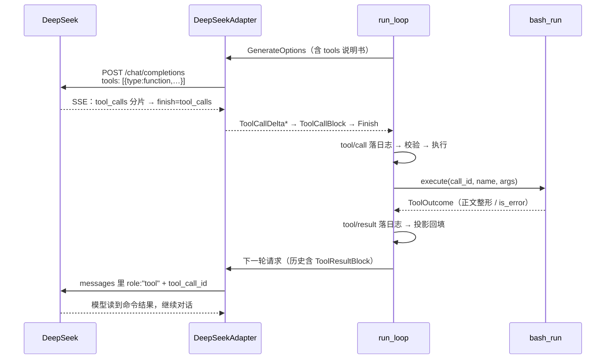

# M3 · 第 3 节 · 工具 wire format：让模型真的调用工具

> 备课出处（选读）：`deepseek-harness` 的 `ab19fed77c`（DeepSeek 适配器）、`packages/llm` 词汇类型；对照本仓库 [src/pagent/deepseek.py](../../src/pagent/deepseek.py) 现状与 [demos/common.py](../../demos/common.py) 里「工具 wire format 是 M3 主菜（M2-01 遗留）」的注记。

## 本节目标

补上全链路最后一块拼图：**adapter 的工具方言**——工具说明书发出去、`tool_calls` 流式收回来、工具结果按 wire 回填。完成后 DeepSeek 第一次真的调用 `bash_run`；收官亲手点：加一个你自己想要的工具。

## 1. 一句话理解

loop 和工具两侧早已就绪，缺的只是 adapter 的三段翻译——**说明书随请求走、`tool_calls` 随流式回、结果按 `tool_call_id` 对账回填**；wire format 只活在 adapter 里，出了这个文件谁都不用知道 DeepSeek 的方言。

## 2. 概念讲解：三侧就绪度盘点

| 侧 | 状态 | 凭据 |
|---|---|---|
| loop 侧 | ✅ M1 全就绪 | `schemas()` 进 `GenerateOptions.tools`、`tool_calls` → 执行 → `tool/result` 落日志、`derive_messages` 投影回填 |
| 工具侧 | ✅ M3-01/02 就绪 | `@tool` 自动说明书 + pydantic 校验 + `bash_run` 真工具 |
| adapter 侧 | ⚠️ **只做了一半** | `translate_event` 已会收 `tool_calls` 分片（M2-01 采过样）；但 `_build_body` **忽略 `options.tools`**，且 content 拼接只认 `TextBlock`——历史里的 `ToolResultBlock` 会被拼成空串（工具结果在上下文里蒸发！） |

adapter 要补的是三个方向：

**请求方向——说明书随行**。`ToolSchema` 直译成 DeepSeek/OpenAI 兼容形状，随请求发出：

```json
{"model": "…", "stream": true,
 "tools": [{"type": "function",
            "function": {"name": "bash_run",
                         "description": "在宿主机 shell 里执行一条命令…",
                         "parameters": {"type": "object", "properties": {"…": {}}}}]}
```

**响应方向——已就绪**。`tool_calls` 流式分片（参数拆多帧、id/name 只首帧出现）→ `ToolCallDelta` → assembler 组装 `ToolCallBlock`（M1-04 就绪）→ `finish_reason: "tool_calls"` → 方向盘判定「欠模型一次请求」→ 执行。这段 M2-01 已通，本节只回顾。

**回程方向——本节新知识点**。工具结果怎么回到模型面前？DeepSeek/OpenAI 用**角色制**：assistant 消息挂 `tool_calls` 数组（它调用过什么），工具结果用独立的 `role: "tool"` 消息逐条回填：

```json
{"role": "assistant", "content": "",
 "tool_calls": [{"id": "call-1", "type": "function",
                 "function": {"name": "bash_run", "arguments": "{\"command\": \"echo hi\"}"}}]},
{"role": "tool", "tool_call_id": "call-1", "content": "hi\n"}
```

注意两件事：① **`tool_call_id` 是对账凭据**——模型按 id 核对「我调的哪个调用、拿到了哪个结果」，必须原样回传；② 我们的中性词汇是 `derive_messages` 产出的 `Message`（assistant 带 `ToolCallBlock`、user 带 `ToolResultBlock`）——「工具结果作为 user 角色」是 M1-02 定的**中性设计**，各家 role 制方言由 adapter 吸收，这正是「词汇表对任何模型都成立」的又一次兑现。



读图要点：adapter 出现两次（请求方向译说明书、回程方向译角色制）——**wire format 的进出都在这一个文件闭合**；loop 对 DeepSeek 的存在零感知。

## 3. 关键代码片段讲解

现状的两处缺口（[src/pagent/deepseek.py](../../src/pagent/deepseek.py)，你 M2-01 的代码）：

```python
def _build_body(self, options: GenerateOptions) -> dict:
    ...
    for m in options.messages:
        content = "".join([tb.text for tb in m.content if isinstance(tb, TextBlock)])
        #          ↑ 只认 TextBlock：ToolResultBlock 被静默丢弃 → content 变空串
        messages.append({"role": m.role, "content": content})
    return {"model": options.model, "messages": messages, "stream": True}
    #     ↑ options.tools 没有出场——模型根本不知道有工具存在
```

读法：这不是 bug，是 M2-01 当时的**范围纪律**（工具 wire format 留给 M3）——现在范围到了。本节编码就是把这两处补全：`_build_body` 增加工具说明书序列化 + 消息翻译升级（assistant 的 `ToolCallBlock` → `tool_calls` 数组；user 的 `ToolResultBlock` → `role:"tool"` 消息）。

## 4. 备课出处（选读）

- `git -C deepseek-harness show ab19fed77c`（DeepSeek 适配器：请求构造与流式翻译的分层，与我们的 TODO(A)~(D) 同构）
- 本仓库 `src/pagent/deepseek.py` 的 `SSE_SAMPLE`（tool_calls 分片的真实 wire 采样，M2-01 教训：每帧都带 `finish_reason` 键、中间帧为 null）
- [demos/common.py](../../demos/common.py) `build_agent` 注释：「工具结果的 wire format 是 M3 主菜（M2-01 遗留）」

## 5. 编码任务

| TODO | 文件 | 语义 | 复杂处 |
|---|---|---|---|
| E | [src/pagent/deepseek.py](../../src/pagent/deepseek.py) | `_build_body` 挂 tools 说明书：`ToolSchema` → `{"type":"function","function":{…}}`（伪代码在 TODO(E) 注释里） | 直译，热身 |
| F | 同上 | 消息翻译升级：assistant 的 `ToolCallBlock` → `tool_calls` 数组；user 的 `ToolResultBlock` → 独立 `role:"tool"` 消息（id 对账）；纯文本走 M2-01 老路 | `_build_body` 整体重构；**顺序约束**——tool_calls 后必须紧跟每个 id 的 role:"tool"，缺则 400 |

作业区（AI）：[tests/test_tool_wire.py](../../tests/test_tool_wire.py)——三条 skip 挂起（E 一条、F 两条）+ 一条纯文本回归护栏当场绿（M2-01 行为不许被重构破坏）。
已备好（AI）：[src/pagent/tool_weibo.py](../../src/pagent/tool_weibo.py)（`fetch_weibo_hot_search` 真工具样板，async @tool）；[demos/common.py](../../demos/common.py) 接线（**导入即注册**——`build_agent` import 两个工具模块，`ToolService` 读全局 `REGISTRY` 自动带上）。

<a id="lesson-log"></a>
### 编码实录

- **TODO(E) 一次成型**：浅改名直译（`ToolSchema` → function-calling 信封），一次通过——M1 词汇表按 wire 形状设计的「翻译成本预付」当场兑现。
- **TODO(F) 的 bug 谱系**（本节的重头）：① `_render_message` 写完**没接线**——`_build_body` 还跑着 M2-01 老路，skip 没解锁时「全绿」是假象，解锁后当场穿帮；② `append`/`extend` 之差——返回的整张列表被当成一条消息塞进去，截断 diff 里的 `[[` 双括号暴露了它；③ `"functino"` 拼写；④ `text`/`content` 变量泄漏——user 分支累加到未定义变量，若上轮循环是 assistant 还会跨迭代串数据（不报错、数据错，最恶劣一类）；⑤ `block.content` 是 dataclass 列表直发 wire；⑥ 纯文本 user 消息缺**最终 flush** 被吞；⑦ 重构 `_build_body` 时**把 system 前置块弄丢**——护栏测试 `test_plain_messages_unchanged` 抓住（继 M3-01 后第二次履行职责）。共性：**bug 全在「边界与接缝」，核心翻译逻辑一次写对**；「写完」和「接进主流程」是两件事。
- **断言可读性改造**（用户促成）：大结构单断言的失败 diff 被 pytest 截断到没法读——两条 F 测试拆成「先量条数、再逐键比」的小断言；工具箱三件：`pytest -vv` 全量 diff、读截断输出的括号形状、断言拆小。失败的测试是被人读得最多的测试，**失败输出是规格 UX 的一部分**。

<a id="qa-wire"></a>
### 对话疑点

**Q9 出站 wire 只能手动拼吗？为什么不上 pydantic/SDK？** 只能且应当手动拼——它其实是**浅改名**：`ToolSchema` 三个字段与 wire 的 `function` 对象近似同构、`parameters` 已是 JSON Schema，翻译只剩加信封（M1 定词汇表时**预付了翻译成本**）。pydantic 的价值在校验**不可信的入站**（fastapi 请求体、工具参数）；出站是自家刚构造的数据，校验等于给刚盖的章再盖一次。openai SDK/litellm 会把 wire 藏进库壳——adapter 的存在意义就是这层翻译。harness 的 TS 同样在运行时手工组装 wire 对象：**类型系统管构造期，运行时 wire 永远是手写形状**。

**Q10 测试失败显示不全怎么办？** 见实录第三条——`-vv` + 括号形状 + 拆断言。另外：护栏测试保持整列表断言是刻意的（它验「完整序列形状」），靠 `-vv` 读。

## 6. 运行与验证

- 全绿：`uv run pytest -q` → **39 passed**（护栏抓住重构丢 system 一次，见实录）
- 收官验收：`uv run python -m demos.echo`，问「今天微博热搜有什么，帮我总结」——看模型真的调 `fetch_weibo_hot_search`，要跑命令时会调 `bash_run`
- **收官亲手点**：写一个你自己想要的新工具（带类型注解的函数 + `@tool(description=…)` 两行装饰），接进对话看模型调它——这就是 M3 的完成标准：「新增一个工具只需写一个带类型注解的函数」

## 7. TS vs Python 差异与坑

- 无新语言差异——本节是新知识在两边对称：harness 的 llm-deepseek 同样要在 adapter 内消化 role 制方言。
- 坑预告：`content` 对 assistant 带 `tool_calls` 的消息应为空串或省略；`role:"tool"` 消息**必须**带 `tool_call_id`，漏了 DeepSeek 直接 400。

## 8. 待探索清单

- 并行工具调用（一条消息多个 tool_calls 的执行顺序与并发）
- function calling 的 strict / json_schema 模式
- MCP 桥：把 MCP server 的工具接进 REGISTRY（M3-01 疑点 Q5 的实装）

## 9. 小结与遗留问题

- 工具全链路 = 说明书随行 + tool_calls 流式回收 + role 制回填，三段都关在 adapter 里。
- `tool_call_id` 是模型的对账凭据，原样回传。
- 遗留：M4 上下文管理（工具结果很长时上下文膨胀——`bash_run` 输出截断的另一半理由）。
