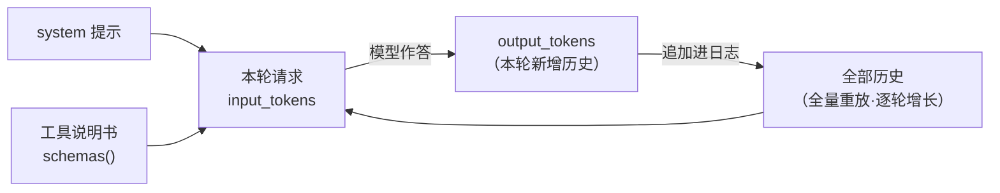

# M4 · 第 1 节 · 上下文是硬预算：token 记账

> 备课出处（选读）：[deepseek-harness/docs/subsystems/compaction.zh.md](../../deepseek-harness/docs/subsystems/compaction.zh.md)（压缩子系统全景：`compaction/*` 会话事件、`CompactionEngine` seam、工具结果剪枝）、[packages/compaction](../../deepseek-harness/packages/compaction)。

## 本节目标

让每次模型调用的 token 消耗**可见**：usage 从 wire 的哪里来、怎么穿过 adapter 落进日志、预算怎么算。记账是管理的第一步——看不见的花销管不住；本节铺好账本，M4-02 才能谈压缩。

## 1. 一句话理解

**上下文窗口是硬预算**：模型一次请求能看到的内容有 token 上限，超了直接报错——而 PAgent 的投影是全量重放（M1-02 定的），意味着**历史越长每轮越贵**，记账就是给「什么时候必须动手压缩」提供数据。

## 2. 概念讲解

### 预算都花在哪

每轮请求的 input 由三部分构成（都从日志投影/装配而来）：



读图一个要害：**output 是下一轮 input 的一部分**——模型说的每句话都永久计入此后所有轮次的预算。这就是为什么 M3-02 的 `bash_run` 输出整形重要：命令输出以 `tool/result` 进历史后**每轮都重发一遍**，长输出的代价是复利的（压缩子系统里专门的「工具结果剪枝」治的就是它）。

### 记账的三个事实

1. **usage 是 provider 报的，不是我们算的**——流式响应里模型方报告本次调用的 token 计数。它藏在哪一帧、要不要开关参数，编码时对着真实响应确认（M2-01 的教训：样例必须忠实于真实 wire，不许脑补）。
2. **M1 埋的伏笔今天到期**：`types.py` 的 `TokenUsage` 与 `UsageChunk` 定义于 M1-01、沉睡至今；M2-01 的 `translate_event` 见到 usage 帧时返回 `[]`（choices 为空直接忽略）——当时是范围纪律，现在范围到了。
3. **usage 不进消息投影**——它是记账元数据，不是对话内容。落日志但 `derive_messages()` 不消费它（对照 session.py 词汇表：投影取类型规则）。这与 `assistant/chunk` 的「落日志但不进模型投影」同构。

### 预算决策点

有了每轮记账，压缩策略（M4-02）才有依据：`input_tokens` 逼近窗口上限 → 触发压缩 → 旧内容摘要替换。harness 的对应物是 `CompactionEngine`（一个 seam，可换策略），压缩动作本身落 `compaction/*` **会话事件**——「压缩也落日志」正是 M1-02 那句「压缩动作本身也落日志」的兑现，模型可见即已记录。

## 3. 关键代码片段讲解

现状的记账缺口（[src/pagent/deepseek.py](../../src/pagent/deepseek.py)，你 M2-01 的代码）：

```python
@staticmethod
def translate_event(event: dict) -> list[StreamChunk]:
    choices = event["choices"]
    if choices == []:
        return []          # ← usage 帧通常正是 choices 为空的帧：账本在这里被丢掉
```

读法：这不是 bug，是 M2-01 的范围纪律——wire 词汇表里 `UsageChunk` 早定义好了，只是没人生产它。M4-01 的编码就是接上这一段。

## 4. 备课出处（选读）

- [docs/subsystems/compaction.zh.md](../../deepseek-harness/docs/subsystems/compaction.zh.md)——`compaction/*` 会话事件、工具结果剪枝、`CompactionEngine` seam（M4-02 的地图）
- 本仓库 `src/pagent/types.py` 的 `TokenUsage`/`UsageChunk`（M1-01 埋的伏笔）；`src/pagent/session.py` 事件词汇表（新增事件先登记的规矩）

## 5. 编码任务

| TODO | 文件 | 语义 | 复杂处 |
|---|---|---|---|
| G | [src/pagent/deepseek.py](../../src/pagent/deepseek.py) | `translate_event` 接回 usage 帧 → `UsageChunk`（**第一步：采样真实 wire**——帧形状、挂靠位置、要不要开关参数，以实测为准，测试断言与实现一起改） | 别脑补 wire（M2-01 教训） |
| M | [src/pagent/loop.py](../../src/pagent/loop.py) | `UsageChunk` 从 chunk 流分流：记 `assistant/usage` 事件（词汇表已登记），不进 assembler、不再混入 chunk 事件 | 账本与内容分流 |
| N | [src/pagent/session.py](../../src/pagent/session.py) | `usage_report()`：日志的又一个投影——扫 `assistant/usage` 事件汇总 input/output | 投影思想的第三次兑现 |

作业区（AI）：[tests/test_usage.py](../../tests/test_usage.py)——三条 skip 挂起（G 一条、M 一条、N 一条），按 G→M→N 顺序解锁。M 的用例顺带锁「chunk 事件里不再泄漏 UsageChunk」。

## 6. 运行与验证

- 基线：`uv run pytest -q` → **39 passed, 3 skipped**
- 实现 TODO(G)（先采样真实 wire，再改断言+实现）→ 解锁第一条
- 实现 TODO(M)、TODO(N) → 全绿 **42 passed**
- M4 收官亲手点在 M4-02：塞爆上下文，对比压缩触发前后的行为与账单

## 7. TS vs Python 差异与坑

- 无语言差异——记账是纯数据流。坑在 wire 细节：usage 帧的形状各家不同（有的随 finish 帧、有的要 `stream_options` 开关），务必以真实响应为准。

## 8. 待探索清单

- harness 的 `CompactionEngine` seam 与压缩策略族
- 工具结果剪枝（toolResultPruner）——bash 长输出的复利账单

## 9. 小结与遗留问题

- 上下文是硬预算，全量重放让历史成本逐轮复利；记账先行，压缩随后。
- usage 是元数据：落日志、不进投影——与 chunk 的待遇同构。
- 遗留：M4-02 压缩策略与「压缩落日志」的兑现。
