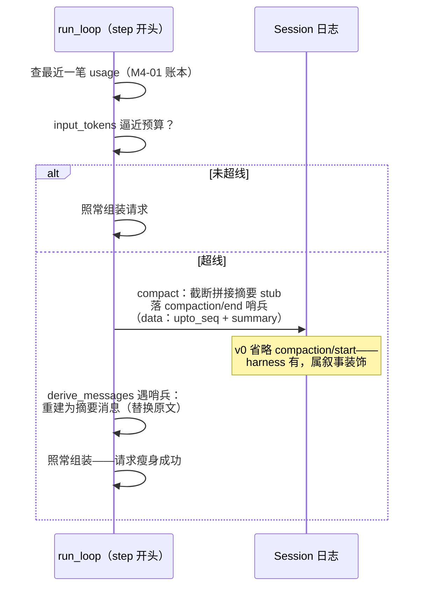

# M4 · 第 2 节 · 压缩：把旧叙事折叠成摘要

> 备课出处（选读）：[deepseek-harness/docs/subsystems/compaction.zh.md](../../deepseek-harness/docs/subsystems/compaction.zh.md)（`compaction/*` 会话事件、`CompactionResult`、`CompactionEngine` seam、工具结果剪枝）。

## 本节目标

上下文不再无限增长：`usage_report` 逼近预算时触发压缩，把旧轮次折叠成一条摘要——**原文退役、摘要上岗**，对话继续而不炸窗口。这是 M4 的收官节，AGENTS.md 的亲手点在这兑现：亲手把上下文塞爆，对比压缩触发前后。

## 1. 一句话理解

**压缩是日志事件，不是删改**：append-only 的日志里没有「删除」这个动作——压缩 = 追加一条「从第 N 轮起请读摘要」的哨兵事件，摘要本身也落日志；`derive_messages` 投影时遇到哨兵就跳过被折叠的原文、插入摘要。日志原样变长，**投影变短**——第 0 课「历史是投影」的终极应用。

## 2. 概念讲解

### 压缩的生命周期



读图三个要害：① **触发点在 step 组装请求之前**（正是「下一轮要发的 input_tokens」逼近上限的时刻——M4-01 账本的消费方）；② 压缩哨兵是**会话事件**——重启后依然生效，这要求摘要必须持久（M6 持久化的预告；harness 另落 `compaction/start` 作叙事装饰，v0 刻意省略）；③ 投影规则是**唯一需要动的既有代码**，loop 和工具零改动。

### harness 对照（刻意取舍都写明）

| harness | PAgent v0 | 处置 |
|---|---|---|
| `CompactionEngine` 是 seam（策略可换） | 决策函数内联在 loop/投影 | 待探索：策略多了再立 seam |
| 摘要由 LLM 生成（自摘要请求） | v0 用**截断拼接 stub** 先跑通管线；真摘要作为加分项 | v0 的正确裁剪 |
| `toolResultPruner` 工具结果剪枝 | 不做——但要知道它是治「bash 输出复利账单」的专项 | 记入待探索 |
| 图片省略、按 token 精细计量 | 不做 | 工程精修 |

### 设计决定：哨兵怎么写进投影

`derive_messages` 的规则（M1-02 定的类型规则）要加一条：遇到 `compaction/end` 事件——**此前的叙事事件不再投影**（已被摘要覆盖），改为投影一条携带摘要文本的合成消息（复用 M1-03 的 `<context>` 信封思想：模型靠信封区分「这是系统折叠的历史」）。**多次压缩**：以最后一次 `compaction/end` 为准。

**折叠对象的判据**：不是「带内容块的事件都折」，而是**投影规则认的五类**（user/message、assistant/message、tool/result、steering/message、context/message）——哨兵重建后，没进摘要的内容会**彻底蒸发**（插话常是关键约束，不可丢）。`assistant/chunk` 与 `usage` 本就不进投影，与压缩无关。摘要里保不保留 tool 调用骨架等精细策略，记待探索。

### 摘要前缀与投影：一套分类学的两种呈现

投影时五类叙事事件被 wire 的 role 枚举**压扁**成两类角色——tool 结果、插话、注入都挂到 user 上，靠结构块与信封标签区分来源。摘要前缀没有这个限制，可以把区分度**还原**：前缀直接取事件类型本身，与投影的区分度一一对应。

| 事件 | 投影形态（wire 压扁后） | 摘要前缀（无限制，可还原） |
|---|---|---|
| user/message | role=user | `[user]` |
| assistant/message | role=assistant | `[assistant]` |
| tool/result | role=user + ToolResultBlock | `[tool]` |
| context/message | role=user + `<context>` 信封 | `[context]` |
| steering/message | role=user + `<steering>` 信封 | `[steering]` |

原则：**事件类型 = 投影的区分度 = 摘要前缀，三层一套分类学**。模型读摘要时的世界结构与读原文时同构——哪句是人说的、哪句是工具产出、哪句是系统注入，压缩前后不变。切忌用投影的 wire 角色（两值）做前缀：那会把已经还原的区分度再次压扁。

## 3. 关键代码片段讲解

投影侧的新规则（[src/pagent/session.py](../../src/pagent/session.py) 的 `derive_messages`，你 M1-02 的代码）——伪代码形状：

```python
for event in self._events:
    if event.type == "compaction/end":
        messages = [summary_message(event)]   # 丢弃此前累积的历史，换成摘要
    elif event.type == "user/message":
        ...  # 原有类型规则不变
```

读法：不是「跳过原文」而是**重建**——遇哨兵时把已累积的 `messages` 整体替换为摘要消息，之后的照旧累积。这比「记住压缩点、分段遍历」简单一个数量级，且天然支持多次压缩（最后一次生效）。

## 4. 备课出处（选读）

- [docs/subsystems/compaction.zh.md](../../deepseek-harness/docs/subsystems/compaction.zh.md)——`compaction/start|end` 事件形状、`CompactionResult`（摘要 + 覆盖范围）、剪枝管线
- 本仓库：`session.py` 词汇表（新增 `compaction/*` 先登记）、`loop.py` 方向盘（触发点的邻居）

## 5. 编码任务

| TODO | 文件 | 语义 | 复杂处 |
|---|---|---|---|
| O | [src/pagent/session.py](../../src/pagent/session.py) | 投影哨兵规则：`derive_messages` 遇 `compaction/end` → 已累积 messages 整体替换为摘要消息（`<compacted>` 信封），之后照旧累积 | 哨兵是**替换不是跳过**；多次压缩天然以最后一次为准 |
| P | 同上 | `compact(upto_seq)`：把覆盖范围的 user/assistant/tool 文本截断拼接成 stub 摘要 → 落 `compaction/end` 哨兵 | append-only 里表达删除 |
| Q | [src/pagent/loop.py](../../src/pagent/loop.py) | 触发判定：组装请求前查最近一笔 usage 的 input ≥ `agent.max_input_tokens`（新构造参数，None=不限）→ `session.compact(日志末尾 seq)` | 触发点在「下一轮 input 成型前」 |

词汇表已登记 `compaction/end`（data：`upto_seq` + `summary`）。作业区（AI）：[tests/test_compaction.py](../../tests/test_compaction.py)——四条 skip（投影重建 / compact 哨兵 / loop 自动触发 / 无预算不触发的回归护栏）。

## 6. 运行与验证

- 基线：`uv run pytest -q` → **42 passed, 4 skipped**
- 实现 TODO(O) → 解锁投影重建；TODO(P) → 解锁 compact；TODO(Q) → 解锁触发与护栏 → 全绿 **46 passed**
- **收官亲手点（M4 正主）**：`demos/echo.py` 给 agent 传 `max_input_tokens=10`（故意极小），连聊几轮——亲手看压缩哨兵落日志、对话照常继续；再把阈值调大，对比账单
- 全绿 + 亲手点完 = M4 关闭

## 7. TS vs Python 差异与坑

- 无语言差异。坑在概念：**append-only 里表达删除**——初学者本能想「改历史」，正确姿势是哨兵事件 + 投影重建；这条想通了，M6 的 replay 也是同一套思路。

## 8. 待探索清单

- `CompactionEngine` 策略族（按 token 精细计量、分段摘要）
- `toolResultPruner`——工具结果剪枝
- LLM 自摘要（另发一次请求总结旧轮次）

## 9. 小结与遗留问题

- 压缩 = 哨兵事件 + 投影重建，原文退役不删除——日志的只追加纪律贯穿始终。
- 触发靠 M4-01 账本，执行靠投影规则，loop 与工具零改动。
- 遗留：M6 持久化（摘要必须能活过重启）。
