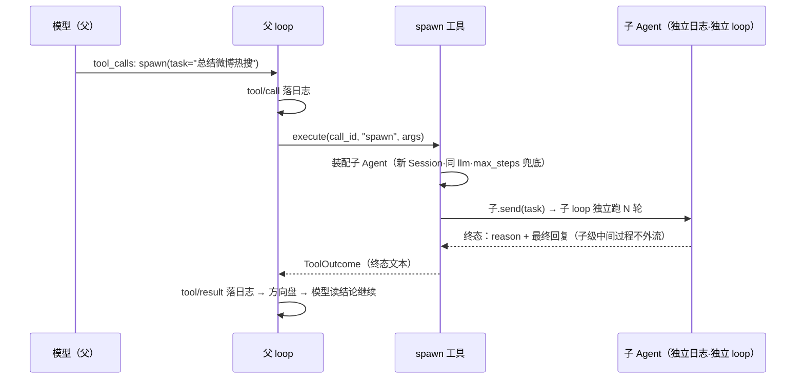

# M5 · 第 1 节 · 委派：把子任务交给另一个自己

> 备课出处（选读）：[deepseek-harness/packages/subagent](../../deepseek-harness/packages/subagent/README.zh.md)（委派能力家族：`ctx.subagents` 注册表、进程内/外提供方、tool-subagent）、[docs/subsystems/subagent.zh.md](../../deepseek-harness/docs/subsystems/subagent.zh.md)（服务约定与终态结果语义）。

## 本节目标

把「派生子任务给独立 agent」做成一个工具：父 agent 调 `spawn`，子 agent 用**同一套零件**独立跑完任务，父级只回收终态结果。完成后，PAgent 第一次有了「团队」——虽然队员是自己的克隆。

## 1. 一句话理解

**子 agent = 同一套零件的第二次装配**：`Agent(session, llm, tools)` 再 new 一个实例（新日志、同款适配器与工具），父级通过一个 `@tool` 工具驱动它、只拿回结论——**子级的中间过程不进父级的上下文**，这是委派的上下文经济学：子级烧五十轮，父级只花几十 token 读摘要。

## 2. 概念讲解

### 委派 seam：又是三角色

harness 的 subagent 家族是能力 seam 的又一次应用：**Definition** = 委派服务（`ctx.subagents`：提供方注册表 + 运行约定 + 终态结果语义）；**Provider** = 一个注册表里的多个实现——进程内新生子级、带父历史的 fork 子级、ACP/Codex/Claude Code 等进程外子级；**Consumer** = 面向模型的委派工具（`tool-subagent`）。**换提供方成片生效**：把「跑个本地克隆」换成「跑个 Claude Code」，父级工具与 loop 一行不改。

PAgent v0 只装第一个 Provider（进程内新生），但接口按 seam 的形状开——未来加 Provider 不动消费者。

### 终态结果语义（回收什么）

子级是一次完整的事件叙事（user/task → turn/step → turn/end），父级回收的只有**终态**：`turn/end` 的 reason（completed/error/max-steps）+ 最终回复文本。中间的 chunk、工具往返全部留在子级自己的日志里——父级日志只多一条 `tool/result`，与调 bash 无异。

### 隔离的边界：共享什么、不共享什么

| | 共享 | 隔离 |
|---|---|---|
| 代码 | Agent 类、loop、adapter、工具实现 | —— |
| 状态 | —— | **Session（日志）、inbox、运行任务** |
| 配置 | 同一个 llm 注册表、同一个 REGISTRY | system prompt 可给子级单独写（「你是负责 X 的助手」） |

一个马上会撞上的设计问题：**REGISTRY 是模块级单表（M3-01 的统一决策），子级 `ToolService()` 一构造就能看到全部工具——包括 spawn 自己**。子级派生子级 = 无限递归，靠 `max_steps` 兜底还是显式屏蔽？v0 的取舍记入编码任务。

### 与 M1-03 steering 的分工

父级在子级运行期间**不能插话**（子级有自己的 inbox，父级拿不到引用）——委派是「交出去等到完」，不是「并行协作」。协作式（向子级发消息、中断、列举状态）是 harness 的 `tool-subagent-control`，记入待探索。



## 3. 关键代码片段讲解

子级的装配就是 M1 那套接线的函数化（对照 [demos/common.py](../../demos/common.py) 的 `build_agent`）：

```python
child = Agent(id=f"{parent.id}-child", session=Session("child"),
              llm=parent.llm,                # 同一个模型服务
              tools=ToolService(),           # REGISTRY 全局单表 → 子级见全部工具
              system_prompt=f"你是专注子任务的助手：{task}",
              max_steps=8)                   # 防跑飞闸对子级同样必备
child.send([TextBlock(text=task)])
run_until_idle(child)                        # 独立事件叙事，跑完即停
```

读法：`run_until_idle`（M1-02 的测试助手）在这里变成生产代码——「跑完当前积压输入即停」正是子级的生命周期。回收即 `child.session.events` 里的最后一条 `assistant/message` + `turn/end` 的 reason。

## 4. 备课出处（选读）

- [packages/subagent](../../deepseek-harness/packages/subagent/README.zh.md)——家族总览：委派服务 + 六种 Provider + 两个工具包
- [docs/subsystems/subagent.zh.md](../../deepseek-harness/docs/subsystems/subagent.zh.md)——服务约定与终态结果语义
- 本仓库 [demos/common.py](../../demos/common.py) `build_agent`（装配线的原型）、[src/pagent/loop.py](../../src/pagent/loop.py) `run_until_idle`

## 5. 编码任务

| TODO | 文件 | 语义 | 复杂处 |
|---|---|---|---|
| R | [src/pagent/tool_subagent.py](../../src/pagent/tool_subagent.py) | `run_subagent`：装配子级 → 派发任务 → `run_until_idle` 跑到终态 → 回收 `[reason] + 最终回复` | **必须 async**（在父 loop 的事件循环里被 execute await，另起 `asyncio.run` 会 RuntimeError）；终态语义含失败（`[error]` 也是数据） |
| S | 同上 | `make_spawn_tool`：闭包 factory 的 `@tool`——父级模型面向的 Consumer | description 是契约的一半（何时委派、只有终态回来） |

已备好（AI）：文件骨架与 TODO 注释；递归取舍已写入文件头（REGISTRY 单表 → 子级可见 spawn，靠 `max_steps` 兜底，显式隔离记待探索）；[demos/common.py](../../demos/common.py) 已接线（工厂闭包造真模型子级）。
作业区（AI）：[tests/test_subagent.py](../../tests/test_subagent.py)——三条 skip（终态回收 / 经 ToolService 的 async 工具路径 / 子级失败语义）。

## 6. 运行与验证

- 基线：`uv run pytest -q` → **46 passed, 3 skipped**
- 实现 TODO(R) → 解锁终态回收与子级失败两条；实现 TODO(S) → 解锁工具路径 → 全绿 **49 passed**
- **收官亲手点（M5 正主）**：`uv run python -m demos.echo`，问「把整理微博热搜的工作委派给子 agent 去做」——观察父级对话里 `tool/result` 只有一行终态结论，子级的全部过程都在它自己的日志里

## 7. TS vs Python 差异与坑

- harness 的进程外 Provider（ACP/Codex/Claude Code）依赖 TS 生态的客户端协议栈——Python 侧对应物是别的世界，v0 不做（记待探索）。
- 坑预告：子级与父级共享 REGISTRY（模块级全局），测试里注册的工具会互相可见——M3-01 作业区注释里提过「REGISTRY 模块级共享」，M5 它第一次产生真实设计后果。

## 8. 待探索清单

- 可继续的子级（continuable：子级保持活着、接受后续轮次）
- `tool-subagent-control`：向子级发消息 / 中断 / 列举状态
- fork Provider（带父级历史出生的子级）
- 进程外子级（ACP / Codex / Claude Code）

## 9. 小结与遗留问题

- 委派 = 委派 seam + 面向模型的 spawn 工具；子级是同一套零件的第二次装配。
- 上下文经济学：子级过程隔离，父级只回收终态——这是「多智能体」的第一性收益。
- 遗留：REGISTRY 单表与子级工具隔离的取舍（编码任务里定）；M6 持久化（子级日志是否入库）。
