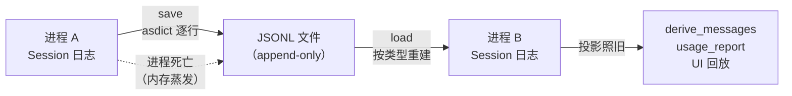

# M6 · 第 1 节 · 会话持久化：日志离开进程

> 备课出处（选读）：[deepseek-harness/docs/subsystems/session.zh.md](../../deepseek-harness/docs/subsystems/session.zh.md)（13 种核心事件变体与投影规则）、[docs/subsystems/persistence.zh.md](../../deepseek-harness/docs/subsystems/persistence.zh.md)（JSONL provider、`session/flush` 检查点、崩溃恢复、SessionHeader）。

## 本节目标

让事件日志**活过进程的生命周期**：落盘（JSONL）、重启恢复、恢复后一切投影照常工作。AGENTS.md 的亲手点在这兑现：亲手重启进程，继续上次对话。

## 1. 一句话理解

**持久化的对象只有一份：事件日志**——因为它是唯一事实来源，模型历史、UI、账本、压缩哨兵全部能从它重建。保存 = 把日志逐行写出；恢复 = 把日志逐行读回；之后整个系统自然「想起」一切——**投影不需要知道进程死过**。

## 2. 概念讲解

### 为什么是 JSONL：格式与纪律同构

日志是 append-only 的，落盘格式选 **JSON Lines**（一行一个 JSON 对象）——文件的写入方式（只追加）与日志的写入方式（只追加）同构。崩溃时最多丢最后没写完的一行，前面的行永远完好。对照 harness：JSONL provider、`session/flush` 检查点、崩溃恢复，同一条思路的工业版。

### 序列化边界是双向的：出容易，进才是主菜

- **出（保存）**：`dataclasses.asdict` 递归转纯 JSON（M3-01 老朋友）——vocab 的 ● 标记字段（dataclass）全部被它转净；编码用 `ensure_ascii=True` 或显式 `encoding="utf-8"`——M4-01 疑点 Q7 的预言兑现：**文件正是「编码未知的消费者」**。
- **进（恢复）**：真正的难点。读回的 `data["usage"]` 是 dict，而投影代码访问的是 `usage.input_tokens` **属性**（M4-01 TODO(N) 的教训「不是 dict 是 dataclass」）——所以恢复时必须**按类型重建**：content 块按 `block["type"]` 分派回 `TextBlock/ToolCallBlock/ToolResultBlock`，usage 重建 `TokenUsage`。**只存不加，读回来就跑不起来**——这就是词汇表要「登记处」的另一半理由：它同时是序列化/反序列化的字段清单。



### 版本化：一行字的远见

harness 的 session 格式从 v0 演化到 v3，每个版本一个迁移包。v0 的最小准备：文件首行写 `{"v": 1, "type": "header"}`——将来格式变更时，恢复代码靠它分派迁移器。成本一行，省掉的是将来的考古。

### harness 对照（刻意取舍）

| harness | PAgent v0 | 处置 |
|---|---|---|
| `SessionPersistence` 接口 + JSONL provider | 模块级 save/load 函数 | 待探索：多后端时立 seam |
| `session/flush` 检查点 + 崩溃恢复 | 每次追加即落盘（demo 规模） | 记待探索 |
| 13 种事件变体的迁移链（v0→v3） | 首行版本号 | 远期 |

## 3. 关键代码片段讲解

恢复方向的类型重建——投影期待 dataclass 属性，所以按 type 分派重建（伪代码形状）：

```python
def _revive_block(b: dict) -> ContentBlock:
    if b["type"] == "text":
        return TextBlock(text=b["text"])
    if b["type"] == "tool-call":
        return ToolCallBlock(id=b["id"], name=b["name"], arguments=b["arguments"])
    if b["type"] == "tool-result":
        return ToolResultBlock(tool_call_id=b["tool_call_id"],
                               content=[_revive_block(x) for x in b["content"]],
                               is_error=b["is_error"])
```

读法：`tool-result` 的 `content` 是块列表——**递归重建**，和 M3-01 讨论 `asdict` 递归时是同一棵树，只是方向相反。

## 4. 备课出处（选读）

- [docs/subsystems/session.zh.md](../../deepseek-harness/docs/subsystems/session.zh.md)——13 变体与投影规则
- [docs/subsystems/persistence.zh.md](../../deepseek-harness/docs/subsystems/persistence.zh.md)——JSONL provider、flush、崩溃恢复
- 本仓库词汇表（session.py）——序列化/反序列化的字段清单

## 5. 编码任务

【待补充——M5-01 完成收尾时与脚手架一同补全（save/load + 按类型重建 + 版本行 + 重启恢复演示）】

## 6. 运行与验证

【待补充——同上】

## 7. TS vs Python 差异与坑

- 反序列化回 dataclass 需要**类型信息**——TS 侧同样要手写 reviver（JSON.parse 不认类型）；两边对称。Pydantic 的 `TypeAdapter` 能按注解自动重建，v0 不引，手写一遍才懂它省了什么。
- 坑预告：● 字段（dataclass）之外，`time` 是毫秒 int、`content` 是列表——恢复函数要覆盖词汇表**每一行**，漏一行就是恢复后某次投影炸 AttributeError。

## 8. 待探索清单

- harness 迁移链 v0→v3（每版一个迁移包）
- `session/flush` 检查点与崩溃恢复
- 多会话存储（SessionStore、fork/resume）

## 9. 小结与遗留问题

- 持久化对象只有日志一份——唯一事实来源让「恢复」退化为「读回」。
- 序列化边界双向：出靠 asdict，进靠按类型重建——词汇表是两者的字段清单。
- 遗留：子级日志是否入库（M5-01 遗留的延续）。
